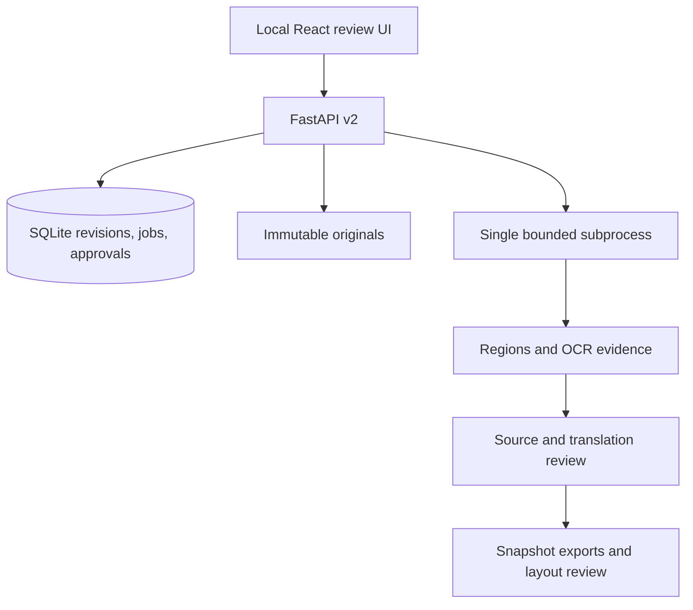
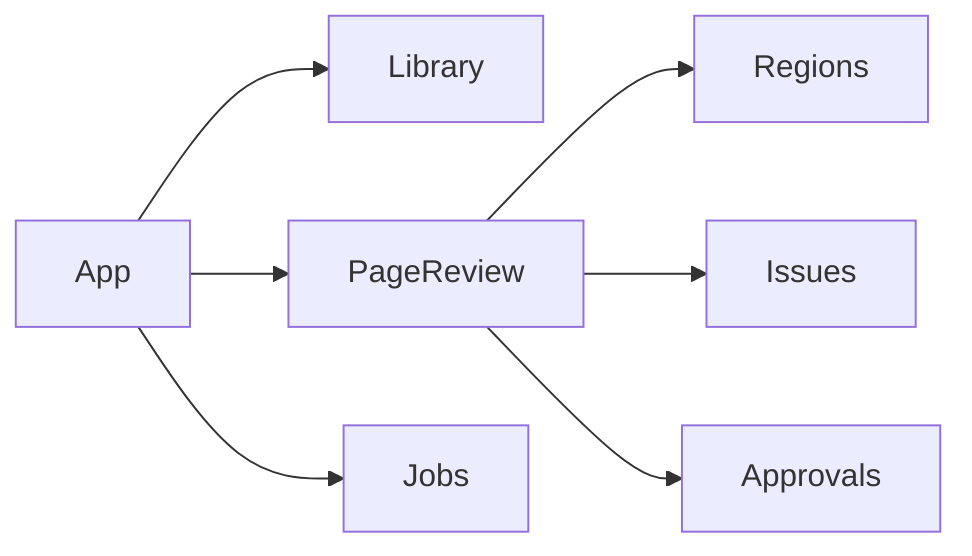

# Detailed development iteration archive

Captured before handoff consolidation on 2026-09-10. Entries describe their state at the time; current status is in root task.md.

# PDF Reader - Development & Task Ledger

> **Last Updated**: 2026-09-10 (Asia/Calcutta)
> **Current Version / Milestone**: v0.2 local review workflow
> **Status**: In Development

## 1. Project Overview & Objectives
Personal Windows PDF reading, Hindi/English translation and verified export. Preserve originals and make uncertain or missing content visible. No universal accuracy claim. Target: existing 8 GB RAM PC, 1,000 pages/500 MB, one heavy worker. Every final translated segment and page requires review.

Tech stack: React 18, TypeScript, Vite; FastAPI/Python 3.12; PyMuPDF, Tesseract, optional qualified Docling/PaddleOCR/IndicTrans2; SQLite and local artifact files. Existing hosted Blob deployment is separate from local runtime.

## 2. System Architecture & Flow Mapping

Directory map: `backend/app/api` schemas/routes; `core` settings/cache; `infrastructure` storage/PDF/process adapters; `services` document/translation/export/review; `backend/tests` regressions and integration; `frontend/src` UI/API/styles; `docs` operations and qualification; `task.md` handoff.

## 3. Environment & Configuration
Python 3.12 and Node/npm required. Existing backend virtualenv and frontend dependencies will be inspected before installation. Defaults: local-only, loopback binding, 500 MB upload, 1,000 pages, one worker, optional model artifacts must be explicitly installed locally. Secrets must not be logged or committed.

Commands (from respective directory): backend `python -m pytest tests`, `python -m uvicorn app.main:app --host 127.0.0.1`; frontend `npm run build`, `npm run dev`.

## 4. Work Tracking & Roadmap
### 4.1 Active Frontier
- [ ] Baseline regressions and repair content loss; implement durable local review pipeline.
### 4.2 Completed Milestones
- [x] Inspected current source and created required ledger before implementation.
### 4.3 Backlog
- [ ] Fix cache, destructive extraction cleanup, reverse cache, stale edits and implicit cloud access.
- [ ] SQLite document/page/region/job revisions; resource-limited import/render/extraction.
- [ ] Whole-page coverage, manual regions, source/translation approvals and glossary.
- [ ] Offline model adapters and honest capability/pilot reports.
- [ ] Snapshot readable/layout exports and approval gates.
- [ ] Optional per-payload approved cloud integration with free-only eligibility checks.
- [ ] Backup/restore, local packaging, regression and acceptance qualification.
### 4.4 Known Issues
Current code silently loses pages above cache capacity, drops legacy Hindi spans, changes numbering, calls external translation/dictionary services implicitly, lacks durable review state. Human reference corpus and qualified local model weights are not present/confirmed; do not fabricate acceptance scores.

## 5. Architectural Decision Records
- ADR-001: Local runtime is the default. No implicit Blob/cloud fallback. Missing models return actionable capability errors.
- ADR-002: Original bytes are immutable. Raw extraction, corrected source and translation are distinct versioned data.
- ADR-003: Final exports require current content and layout approvals; failure/uncertainty cannot become a blank successful page.
- ADR-004: Single bounded worker, incremental pages, durable checkpoints. Cache eviction changes performance only.

## 6. Iteration & Change History
| Date | Iteration | Changes | Files | Verification |
|---|---|---|---|---|
| 2026-09-10 | Initialize | Read tracker/PDF skills and inspected baseline | task.md | Git working tree initially clean |
| 2026-09-10 | Foundation 1 | Request-owned page results prevent cache eviction loss; missing pages now error; explicit local runtime and resource defaults | document_service.py, config.py, api.ts, .gitignore | Regression verification pending; creating working Python 3.12 environment |
| 2026-09-10 | Foundation 2 | Transactional documents/pages/jobs, optimistic edits, explicit approvals, issue acknowledgement, context invalidation, glossary and immutable snapshots | core/review.py, infrastructure/review_store.py | Tests pending route/worker integration |
| 2026-09-10 | Worker | Isolated parsing/rendering/OCR with Windows Job Object memory boundary, wall timeout, cancellation, explicit Hindi+English data prerequisite, raw evidence and coordinate inventory | bounded_worker.py, worker.py, structured_pdf.py | Integration tests pending; OCR results intentionally remain unapproved |
| 2026-09-10 | Translation/jobs | Offline-only IndicTrans2 adapter, qualified hashed model manifest, token-boundary coverage and truncation rejection; single durable consumer with stale checkpoint rejection | local_translation.py, review_jobs.py; legacy reader/language fixes | Model download requires gated upstream access; no real inference qualification claimed |
| 2026-09-10 | Export | Shaped readable PDF, DOCX/TXT, static original-plus-translation companion, bounded digital-text layout replacement and explicit overflow/form/raster blockers | review_export.py | Rendering and export integration verification pending; final Word layout approval unavailable until separately qualified |
| 2026-09-10 | API/backup | v2 imports/password sessions, page regions, revision editing, approvals, jobs, exports/layout gates, local origin/token boundary; SQLite backup and checksum-verified restore into new directory | review_routes.py, main.py, review_backup.py | Integration verification pending; legacy routes blocked in local mode |
| 2026-09-10 | Review UI | Local library, whole-page region overlays and drawing, side-by-side transcription/translation, terminology, explicit approvals, issue notes, jobs, snapshot preview and layout-gated download | ReviewWorkspace.tsx, reviewApi.ts, review.css, main.tsx | TypeScript build and end-to-end checks next |
| 2026-09-10 | Verification suite | Added long-cache, missing-page, semantic issue, approval, stale edit/worker, restart, token coverage, backup, password, isolated process and Hindi export tests; pinned local dependencies | test_review_workflow.py, requirements-local.txt | Running now; no synthetic results represented as model accuracy |
| 2026-09-10 | Build/OCR setup | Frontend build passed; isolated Python 3.12 core environment installed. Downloaded local Hindi tessdata_fast at 87416418657359cb625c412a48b6e1d6d41c29bd; copied existing English/OSD into project-local ignored models; workers use this directory. Snapshot transactions made consistent; worker stdout isolated from library diagnostics | bounded_worker.py, worker.py, review_store.py, ignored models/tessdata | First regression run: 9 passed, 11 setup errors from missing parent temp directory; corrected directory and rerunning |

| 2026-09-10 | Integration fixes | Explicitly close SQLite backup/restore handles on Windows; corrected export INSERT placeholder count | review_backup.py, review_routes.py | Prior run: 18 passed, 2 failed; failures addressed and rerunning |

## 7. Deployment Ledger
Browser QA passed its initial nine workflow checks. Expanded to unsaved-text recovery, manual region drawing and cloud preview without transmission. Removed legacy Google Fonts links from index.html so the local UI has no font/network dependency; browser suite now blocks and records any external request. Generated Hindi output visually verified with independent Poppler rendering as well as MuPDF. Files: index.html, review-browser.mjs.

Final artifact integrity: export SHA-256 is recorded and checked before layout approval/final download, blocking external byte changes. Added positive API test completing all reviews, then tampering with bytes and changing source revision to prove both final gates close. Files: review_routes.py, test_review_workflow.py. Test run pending.

Operational handoff added: Start-Local.ps1, Setup-Local.ps1, verified restore CLI, local model qualification manifest CLI, and docs/LOCAL-DEVELOPMENT.md with exact capabilities/remaining gates. Legacy live-provider tests are opt-in, avoiding accidental external calls in the default suite. Latest backend suite: 61 passed; browser regression rerunning after actual job pipeline and Unicode fixes.

Resolved job pipeline bug: successful extracted pages carry `error: ""`; bounded_worker mistakenly treated any `error` key as failure and then raised KeyError reading an absent message. It now checks a nonempty error. Fixed an additional Windows font handle leak on rejected faithful-layout exports by fully loading/closing the font before fitting. Latest pre-fix run: 28 passed, 2 failed. Files: bounded_worker.py, review_export.py.

Job consumer investigation: browser observed a paused extraction job with the generic unexpected-failure message. Added a real bounded-worker-to-job-checkpoint regression and exception-class/stack-only diagnostics (no document text or exception payload). This closes a test gap left by isolated worker/store tests. Files: review_jobs.py, test_review_workflow.py.

Browser import now reaches the API; test encountered the expected low-memory pause because opening Chrome reduced free RAM below the 1 GB production reserve. This is a measured operating limitation, not a successful target-hardware qualification. Browser tests will use a separate QA workspace with a 512 MB worker cap and smaller free-memory threshold for tiny fixtures; production defaults remain unchanged. Cloud boundary and overflow/companion/DOCX tests added.

UI hardening: unsaved source/translation text is retained in browser storage and recovered visibly after reload; explicit save remains authoritative. Manual page completion has a usable review path. Optional cloud payload preview/one-job approval UI added; sending remains disabled without eligibility credentials. Files: ReviewWorkspace.tsx. Browser tests will cover recovery and disabled cloud.

Hardening iteration: retained annotation/form evidence as unresolved regions; faithful export refuses unqualified annotations/forms/raster backgrounds even when UI content types change. PDF export verifies every expected region's text in addition to render success. Glossary precedence/direction now deterministic. Manual transcription endpoint added for pages that cannot be automatically processed. Files: structured_pdf.py, review_export.py, review_store.py, review_routes.py. Regression additions and browser recheck pending.

Browser QA found the existing frontend environment could override the packaged local API origin, causing fetch failures. Local production now forces same-origin; local development uses 127.0.0.1:8000. Updated reviewApi.ts and browser test failure capture. Rebuild and rerun required.

Optional cloud adapter implemented: explicit preview/hash approval, source/document revision binding, one-use requests, public-nonpersonal requirement, fresh API key ownership + empty billing account verification, seven-day policy review expiry, quota/truncation/schema fail-closed behavior. No live cloud requests made; account credentials are absent. Local operation is independent. Changes: approved_cloud.py, review_routes.py, config.py. Mocked boundary tests next.

Existing Vercel configuration retained; no remote deployment performed. Local server started at http://127.0.0.1:8000 using backend/.venv-local Python 3.12, process 18828 (unified exec session 99371). Frontend production build served by FastAPI. Browser qualification script added under frontend/tests/review-browser.mjs; generated captures stay in ignored tmp/browser-qa.

## 8. Agent Handoff & Continuity Guide
Current mental model: local v2 workflow has been implemented with SQLite state, bounded workers, region drawing/editing, source/translation approvals, immutable exports and final PDF layout gates. Frontend builds. New regression suite had 18 passes and 2 failures (Windows backup handle cleanup, export SQL placeholder count); those fixes are now applied. Continue running tests and repair issues, then browser QA, packaging and capability documentation. Use backend/.venv-local/Scripts/python.exe (Python 3.12.14); old .venv/.venv-repaired reference a missing interpreter. Local Hindi/English Tesseract data exists in ignored backend/models/tessdata. IndicTrans2 weights/runtime and advanced Docling/Paddle qualification are absent; cloud account/free eligibility unavailable. No real translation accuracy claim or human acceptance corpus exists. User's latest instruction is continue development and comprehensively test before reporting completion. No server has been started yet. Git needs per-command safe.directory; do not change global config.

Implementation iteration: legacy span omission, destructive OCR cleanup, numbering repair, scan regex, substring domain matching and fabricated reverse cache corrected. Legacy editor now preserves edits arriving during translation. Tests pending.

Verification iteration: all 20 new workflow tests passed after backup/export fixes. Combined suite 46 passed / 5 failed because five legacy tests required the superseded destructive behavior. Updated those tests to assert preserved raw Hindi/OCR/numbering and independently computed reverse translation; no network tests executed against real providers.

Verification: 51 backend tests passed (review workflow plus legacy offline/mocked regressions); 6 dependency deprecation warnings only. New workflow suite separately 20/20 passed. Optional RapidOCR startup message now accurately describes the Tesseract fallback. Frontend browser QA running; playwright added as dev dependency, npm audit reports 0 vulnerabilities.

Export QA found a true hidden-text defect: MuPDF HTML shaping rendered Hindi correctly but encoded several conjuncts as unrelated Unicode characters. The same failure reproduced on candidate PyMuPDF 1.28.2, so the upgrade was not adopted. Switched new PDF text authoring to fpdf2 2.8.8 + uharfbuzz 0.56.1 using locally installed Nirmala font, with correct ToUnicode in the isolated experiment. PyMuPDF remains the parser/renderer/overlay compositor. Readable and faithful exporters now use this path, and complete text comparison remains enforced with canonical Unicode normalization. Retest/render inspection pending.

Browser test now reaches completed extraction and renders region overlays correctly. Found ambiguous select accessible names because option text was included in nested labels; added explicit accessible names. Added npm test:browser command. Rebuild/retest next.

Integrity audit iteration: extraction now refuses to replace existing regions on pending pages, with a second guard at checkpoint; source/context edits and new regions invalidate sibling approvals as well as other pages; already-target content requires a confirmed language matching the document target, and target changes invalidate its source approval. Files: core/review.py, infrastructure/review_store.py, services/review_jobs.py, tests/test_review_integrity.py. Focused regression run pending.

Audit hardening: runtime_mode now validates local/hosted, preventing typo-enabled legacy network paths. Export verification records each text region's output page and bounding boxes (including readable page breaks/companion offsets), checks at those locations, and retains the map in export provenance. Repeated-clause deletion mutations and invalid configuration regressions added; approval test helper now completes edits before approvals. Files: config.py, review_export.py, test_export_edges.py, test_review_workflow.py. Verification pending focused run.

Focused export/workflow tests: 31 passed after location mapping; mutation tests catch omitted repeated passages. Frontend stable text field labels and library status refresh fixed. Added pre-parser request limits for declared/chunked bodies, removed testserver from production Host allowlist, and moved test clients to loopback origin. Files: body_limit.py, review_routes.py, test_review_workflow.py, ReviewWorkspace.tsx. Follow-up verification pending.

Integrity audit verification: focused test_review_integrity.py passed 16/16 using backend/.venv-local/Scripts/python.exe from the backend directory. Cases include manual edits before/during extraction, checkpoint overwrite rejection, pristine extraction success, same-page/cross-page source-context invalidation, target-language mismatch, and target switching without reviving approvals. First collection attempt from the project root lacked the app import path; rerun from backend passed. Existing workflow approval fixtures must edit all context fields before approving segments.

Export boundary investigation found a real fpdf2 secondary Indic glyph extraction defect (extra ASCII character in सत्यापित), rather than missing layout text. Added standard per-rendered-line ActualText with PDF 1.5 declaration and retained bounding-box verification. Unsupported font glyphs now explicitly block export so replacement text cannot conceal a missing visible glyph. Multipage/repeated-clause/glyph regressions added. Browser validation: 14 checks passed with actual decoded export preview, unsaved recovery, draw-region, zero external requests; stable labels, sidebar refresh and preview-loading approval guard fixed. Portable synthetic browser fixture included. Files: review_export.py, test_export_edges.py, ReviewWorkspace.tsx, review-browser.mjs, fixtures/sample.pdf. Final suite and independent render/text checks next.

Latest full-suite run: 88 passed, 1 failed, 1 skipped. New missing-glyph mutation proved HarfBuzz does not populate fpdf2's missing_glyphs list consistently. Added pre-render cmap validation (with explicit zero-width shaping controls), so ActualText cannot certify absent glyphs; retain fail-closed layout handling. Captured complete tested Python dependency lock and setup now uses it. Files: review_export.py, requirements-local.lock.txt, Setup-Local.ps1. Retest pending.

## 2026-09-11 continuation: reading order and Hindi PDF compatibility

These entries record intermediate states; task.md and IMPLEMENTATION-VALIDATION.md describe the current outcome.

2026-09-11 compatibility iteration: measured PDF.js 6.3.289 on the two-page Hindi fixture; it ignored ActualText and produced 200 extra ampersands, while MuPDF extracted correctly and Poppler rendering was visually correct. Empty/null/zero-width CMap experiments did not produce correct copy text and were not adopted. Export now records a blocking reader-compatibility issue for unmapped secondary shaped glyphs; readable PDF visibly reports the limitation, faithful mode refuses it, and API final-download gate inherits the blocker. No claim of cross-reader completion. Files: review_export.py, review_routes.py, test_export_edges.py. Removed one trailing-space diff warning. Regression and current server refresh next.

2026-09-11 review issue visibility: export panel now lists each actual blocker instead of suggesting content approval always resolves it. API regression covers a fully content-approved document whose PDF.js compatibility issue still blocks layout/final approval. Files: ReviewWorkspace.tsx, test_review_workflow.py. Build and final integration verification pending.

2026-09-11 documentation iteration: validation/operation records distinguish resolved defects from the contained PDF.js incompatibility; exact 200-error synthetic measurement and failed temporary CMap experiments recorded. No experimental mappings adopted. Files: IMPLEMENTATION-VALIDATION.md, LOCAL-DEVELOPMENT.md, task.md. Final tests running.

2026-09-11 final verification: 90 backend tests passed / 1 intentional live-provider skip in 70.12 seconds, six dependency deprecation warnings. Frontend build and 14 Chrome checks passed on the current code; latest UI/export screenshot visually inspected. git diff --check clean; PowerShell start/setup scripts parse without errors. Prior QA and normal servers stopped only after verifying their owned process IDs; restarting latest normal server with production defaults.

2026-09-11 server handoff: http://127.0.0.1:8000 is healthy and serves current index-Diwy0jk9.js. Confirmed local capabilities, 3072 MB worker limit, legacy routes return 410 and unauthenticated mutation returns 403. Translation capabilities explicitly report missing/unqualified model prerequisites. User state retained. This is a testable development build, not completion of all revised-plan release gates.

2026-09-11 continuation: local server22952/port8000 confirmed healthy for concurrent user testing. Implemented revision-bound reading-order correction: exact unique region-ID permutation, preserved all evidence/text, audit trail, translation/completeness invalidation and earlier/later controls. Added 11 store/API/fault regressions; all passed in4.60 seconds. Generation now visibly explains and disables only confirmed missing model directions; manual translation remains available. Files: review_store.py, review_routes.py, ReviewWorkspace.tsx, test_reading_order.py. TypeScript/browser checks pending. Chrome152 PDF pilot rejected: visible rendering correct but PDF.js lost53 normalized codepoints and returned0/15 expected सत्यापित perpage; original export architecture unchanged. Additional vector-visible/logical-text-layer feasibility experiment in ignored tmp only.

2026-09-11 browser regression expanded: correction can move a reviewed region later/earlier, preserve its identity and transcription across reload, invalidate translation approval, then accept a fresh review. Added a missing-local-model disabled-button/explanation check. Reading-order TypeScript validation passed. Files: review-browser.mjs. Build/browser run next; production8000 remains available.

2026-09-11 export development: vector-outline visual layer plus invisible direct-Unicode text passed the bounded two-sentence Hindi/English prototype in MuPDF and PDF.js (exact सत्यापित1/1, no ampersands/nulls). Render comparison found zero unmatched ink beyond a one-pixel neighborhood; visually inspected. Implemented generated-page-only conversion with no residual visible-layer text, per-line text validation, page dimension/appearance checks, and bounded SVG size. Originals are never converted; failure blocks export. Files: compatible_pdf.py, review_export.py. Integration, multipage and PDF.js tests pending; prior compatibility blockers are removed only by a successful checked conversion.

2026-09-11 compatibility tests: updated the prior known-failure expectations to require successful checked text-layer conversion and final approval for the difficult Hindi sample. Added visible deletion/addition/color/dimension mutations, exact varied Hindi line with a colored vector background, and injected incorrect hidden text; these must fail the appearance/content safeguards. Files: test_compatible_pdf.py, test_export_edges.py, test_review_workflow.py. Full integration tests and independent PDF.js qualification next.

2026-09-11 integration finding: initial pixel-color comparison rejected unchanged small text because SVG outlines omit font grid hinting (edge gray differences up to40/255). Diagnostic renders were inspected at4x; text/positions were unchanged. Appearance verification now checks ink geometry within one pixel in both directions and color on flat regions (8/255 tolerance), while deletion/addition/color/dimension mutation tests remain mandatory. Files: compatible_pdf.py. Browser suite with reading-order/missing-model checks passed16/16; compatibility regression rerun follows.

2026-09-11 independent compatibility result: PDF.js6.3.289 now reads all200 exact सत्यापित occurrences across2pages with no ampersands/null/replacement characters. PDF.js first-page rendering was generated and visually inspected. The40 focused export/API/mutation tests passed in84.93 seconds. Added faithful-overlay transparency/background preservation test and report output-location/encoding provenance; removed obsolete compatibility blocker helper after successful conversion checks. Files: verify-pdf-text.mjs, test_export_edges.py, review_routes.py, review_export.py. Final regression run pending.

2026-09-11 operations/docs iteration: production server refreshed to process22716/session19757 at port8000, serving latest reading-order UI; earlier server22952 was verified before stopping. Operation/validation docs now describe the new checked Hindi encoding, approximate selection geometry and reproducible PDF.js qualification command. Files: task.md, LOCAL-DEVELOPMENT.md, IMPLEMENTATION-VALIDATION.md. Final combined tests and server health checks still pending.

2026-09-11 final continuation verification: 108 backend tests passed/1 intentional live-provider skip (477.24 seconds wall time, six dependency warnings); current build and16 Chrome checks passed. Independent PDF.js6.3.289 checks: two-page Hindi 200/200 exact शब्द; full varied-Hindi text/color fixture; full faithful overlay text/background fixture, all passed and rendered pages inspected. Local8000 health/current bundle index-Dt9FAc1k.js/reading-order API confirmed. Section8 current frontier updated; remaining model/structure/corpus work is not represented as complete.

## Archived continuation notes through2026-09-20

2026-09-11 19:10 documentation continuity: moved historical intermediate compatibility/reading-order entries to docs/DEVELOPMENT-ITERATIONS.md; corrected the current verification table and QA server status. Normal server 22716 is healthy at port 8000. An independent export integrity audit is in progress; no model or advanced-structure completion claim. Files: task.md, docs/DEVELOPMENT-ITERATIONS.md. Documentation-only change; no tests required.

2026-09-11 export audit correction: reproduced false acceptance of changed word spacing (not able / notable), a longer amount (100 / 1000), and a duplicate clause in the same output allocation. PDF verification now requires exact NFC text with whitespace collapsed, preserving word boundaries; substring matches and added text fail. Added four error injections and a normal line-wrap acceptance case. Files: review_export.py, test_export_edges.py, task.md. Focused regression run pending; running server still uses its previously loaded revision until refreshed.

2026-09-12 continuation: focused run passed 56 tests but one isolated preflight exceeded its 30-second timeout; rerun and investigation pending. Export audit also reproduced unqualified retained Hindi and reversed logical reading order in mixed faithful output. Added residual-source Devanagari refusal after redaction, full-page ordered text equality, authored-text encoding scope and verification version 2. Older exports remain available as review copies but cannot inherit current final approval. Files: review_export.py, review_routes.py, task.md. Regression tests and server refresh pending.

2026-09-12 export regression cases added: retained original Hindi is refused by faithful mode but rebuilds through readable mode; fully replaced Hindi-to-English remains eligible; mixed English retention/translation must preserve whole-page copy order, including both rejected and accepted arrangements. Assert original bytes are unchanged and report scopes authored text. Files: test_export_edges.py, task.md. Independent agent owns only the version-gate API tests; parent owns production changes.

2026-09-12 resource observation: available system RAM was approximately 716 MB, below the normal 1 GB scheduling reserve. Stopped only the verified owned QA server940 on port8001 to reduce idle load; production22716/8000 remains healthy. Production limits are unchanged. Backend export regressions are still running. Files: task.md (runtime ledger).

2026-09-12 documentation update: operating instructions now explain layout-preserving logical-order and retained-Hindi limitations, exact allocation checks and regeneration of older exports. Validation report distinguishes the previous passing suite from current pending regression tests and records the timeout without asserting an unproven cause. Files: docs/LOCAL-DEVELOPMENT.md, docs/IMPLEMENTATION-VALIDATION.md, task.md.

2026-09-12 01:29 verification/runtime: all 22 focused export/preflight tests passed in 112.43 seconds, including the previously timed-out isolated preflight. Version-gate API tests passed 3/3 in 11.15 seconds using lightweight seeded artifacts. Full backend suite is running. Confirmed zero queued/running production jobs, stopped verified server22716, and started current code at http://127.0.0.1:8000 (process5848/session96035); health passed. Files: test_export_version.py, task.md. User records/originals retained.

2026-09-12 Section8 continuity updated with the current export audit safeguards and server revision; full backend rerun and browser smoke remain pending. Files: task.md.

2026-09-12 full backend verification: 120 passed, 1 intentional live-provider skip, six dependency warnings, 168.11 seconds. The earlier worker timeout did not recur. Started separate QA25320/session26236 at port8001; browser run58940 is in progress. Production5848/8000 remains available with unchanged resource limits. Files: task.md, docs/IMPLEMENTATION-VALIDATION.md.

2026-09-16 continuation: previous browser repeat completed successfully (16/16, no browser exceptions/external network requests). All old Python servers had ended; restarted current local application at http://127.0.0.1:8000, process16312/session49770. User requests completing remaining product work. Parallel bounded tasks: primary-source research for a lawful ungated CPU translation baseline; native ruled-table proposals; static form stored/appearance evidence. Parent owns integration, review rules and tests. No universal accuracy or full release claim. Files: task.md (planning/runtime update).

2026-09-16 structure-review foundation: added explicit table proposal adoption/structure approval/not-table decisions. Adoption preserves prior native regions as evidence and refuses edited/overlapping/cross-boundary or text-mismatched replacements. Cell regions retain grid coordinates/spans; structural approval is separate and invalidated by context changes. Form source approval now requires a saved value/appearance reconciliation note. Added versioned table review route and schema fields. Files: core/structure_review.py, core/review.py, review_store.py, review_routes.py, task.md. Detector integration, UI and regressions pending; running server remains at its loaded previous revision.

2026-09-16 table integration: native ruled-table helper and synthetic tests added by the structure agent; parent attached proposals to page extraction and added bounded table previews, adoption/review controls, and preserved cell metadata in frontend types. Table review requires contiguous row/column reading order; cell edits clear structural approval. Form reconciliation note is included in revision-safe saves and browser text recovery. Files: table_structure.py, test_table_structure.py, structured_pdf.py, structure_review.py, review_store.py, reviewApi.ts, TableReviewPanel.tsx, ReviewWorkspace.tsx, task.md. Rendering/export grouping and end-to-end tests pending.

2026-09-19 continuation: completed form evidence integration into region extraction and UI. Original stored values, appearance text/state, contradictions and provenance remain separate; every form source needs an explicit reconciliation note. XFA is rejected with an actionable static-copy instruction. Table preview styling and cell coordinates added. Native table helper previously passed 11 focused tests; form helper previously passed 14 before interruption, with finishing checks delegated. Public OPUS-MT/CTranslate2 installation/adapter implementation delegated; parent continues table exports and integration. Files: structured_pdf.py, ReviewWorkspace.tsx, review.css, task.md. Full new-suite/UI verification pending.

2026-09-19 form and detector gates: finished form helper passed 17 tests in 2.91 seconds. Null form-evidence hashes cannot acquire source approval. Whole-page coverage requires an explicit fingerprint-bound note for failed table detection or unassigned-grid warnings, with a matching UI field; a successful paragraph review cannot conceal these warnings. Local server restarted process18168/session60311 after old processes ended. Files: structure_review.py, review.py, review_store.py, reviewApi.ts, ReviewWorkspace.tsx, task.md. Regression additions delegated; final tests pending.

2026-09-19 structured export development: readable PDF draws adopted table cell boundaries with native width proportions, explicit row/column spans, bounded pagination of merged groups and per-cell text-location validation. DOCX emits actual merged grid cells; TXT labels row/column/span relationships. Table cells must remain contiguous and correctly ordered. All export formats now reject XFA before writing; verification version increased to 3 so older snapshots cannot bypass stronger gates. Files: table_export.py, review_export.py, test_export_edges.py, task.md. Export tests/render inspection pending; authored table text still requires ordinary content and page approval.

2026-09-19 table visual preservation and model setup: table PDF/DOCX cells marked for visual preservation now embed bounded crops of the original instead of becoming empty cells. Structure integration tests passed 22 cases in 16.06 seconds. Translation agent added hash-pinned optional Windows dependencies and an explicit public-model installer with bounded safe extraction, provenance, attribution and conversion manifests; no downloaded source script is executed. Files: table_export.py, review_export.py, requirements-translation.txt, tools/install_marian.py, test_structure_review.py, task.md. Actual model conversion/inference and table export tests remain pending.

2026-09-19 form migration correction: 19 integration cases exposed missing/empty legacy form-evidence records bypassing the null-hash guard (17 passed, 2 failed). Tightened both source approval and final content rules to require evidence for every form-field method, including older records. Original snapshots remain available; incomplete fields cannot be approved. Translation subagent stopped at its usage limit, so parent is inspecting and completing its partial runtime work. Files: review.py, review_store.py, test_form_review.py, task.md. Retest pending.

2026-09-19 CPU translation adapter: public archives and hash-pinned CTranslate2/SentencePiece runtime are present. Added the missing offline adapter with file-integrity/runtime guards, source-offset alignment, explicit token bounds, actual EOS requirement, unknown-token failures and unapproved draft provenance. Inspected upstream preprocessing scripts without executing them; intentionally corrected their fullwidth-one-to-quote mapping and reject number-changing normalization or unsupported control removal. Added real runtime-smoke entry point for the explicit installer. Files: marian_translation.py, install_marian.py, task.md. Conversion, actual inference, dispatcher integration and regressions pending; no language-quality certification.

2026-09-19 focused verification: 70 form/table detection/review tests passed in 27.30 seconds, including the fixed legacy evidence bypass. Table export tests passed 9 cases in 13.12 seconds; Hindi output visually inspected. A final source-crop pixel comparison was added and awaits the combined rerun. Frontend build passed with existing Browserslist/Tailwind warnings. Installer audit corrected deletion of another installer's partial download, normalized ZIP path aliases, and missing runtime-version manifest validation. Files: test_table_export.py, install_marian.py, marian_translation.py, task.md. Actual model conversion next; no heavy table tests will run concurrently.

2026-09-19 local AI milestone: both public native OPUS-MT directions converted to CTranslate2 INT8 and passed real offline runtime smoke tests; manifests/license/attribution are installed under backend/models/marian, with report in ignored tmp/marian-pilot/installed.json. No model quality certification or document upload occurred. Dispatcher selects the installed local baseline only when qualified IndicTrans2 is unavailable; failures do not trigger any online fallback. UI labels baseline output as drafts requiring review. Files: local_translation.py, reviewApi.ts, ReviewWorkspace.tsx, task.md. Bounded-worker/job, extended pilot and browser tests pending.

2026-09-20 continuation: both local models occupy approximately 85 MB per direction; four real smoke examples per direction completed in 0.935s/1.094s with end-of-smoke RSS156.51/162.52MB. A Hindi legal example produced an incorrect role/currency rendering; existing number and fact-relationship checks require review, and no legal quality qualification is claimed. Added explicit Setup-Local -InstallTranslationModels option. Installer raw ZIP names now use orig_filename so Windows sanitization cannot conceal forbidden names. Files: install_marian.py, Setup-Local.ps1, task.md. Final mocked tests, bounded runtime/job pilot and browser runs pending.

2026-09-20 integration pilot added: opt-in real local-model API tests create three synthetic pages per direction, import immutable originals, extract, explicitly approve source, run the durable translation queue, verify complete input offsets and unapproved output, generate a draft, and assert final download remains blocked. They use the separate tiny-fixture 512MB worker/128MB reserve; this is not production workload qualification. Frontend build passed (index-DwckcR7e.js). Files: test_local_model_integration.py, task.md. Running real pilot and full regression next.

2026-09-20 installer repeat safety: mocked adapter/installer suite passed 57/57 after raw ZIP-name correction. Added hash-verified reuse of an exact existing installation, including recipe/archive/license/runtime-smoke/file-inventory checks before any heavy import; damaged, changed or malformed installations are left untouched with an explicit move-aside instruction. Added no-network/no-inference and immutability regressions. Files: tools/install_marian.py, test_marian_translation.py, task.md. Expanded focused test run pending; parent owns current main Section 8 refresh.

2026-09-20 installer repeat verification: all 74 mocked installer/adapter tests passed in 6.52 seconds, including 17 new exact-reuse and refusal/immutability cases. An initial invocation from the project root failed test collection because app imports require the backend working directory; the correct backend invocation passed. Files: tools/install_marian.py, test_marian_translation.py, task.md. No weights downloaded, converted or inferred during this focused verification.

### 2026-09-20 — integrated browser checks and model memory diagnosis
- New structure browser suite passed 11 checks and existing review suite passed 16 on isolated QA8001; native table adoption/blank cells/approval invalidation and stale form appearance reconciliation verified in desktop/mobile UI. Added frontend/tests/structure-browser.mjs and fixtures/structure.pdf.
- Real model API pilot exposed MKL allocation failure at an artificial512MB worker cap (also reproduced at768MB); one synthetic translation succeeded under the configured3072MB production cap. This is not a measured quality or memory-peak benchmark.
- Worker now loads only the runtime for its selected operation and maps known allocation failures to an actionable worker_memory result without exposing document diagnostics. Added tests/test_worker_errors.py; integration pilot uses normal3072MB cap with explicitly test-only128MB free reserve. Reruns pending.
- Normal local server started at http://127.0.0.1:8000 (PID19068); QA8001 separate data/models. Production resource defaults unchanged.

### 2026-09-20 — real local translation API pilot passed
- Both3-page synthetic directions passed immutable import, extraction/source review, offline queued translation, complete source offsets, saved unapproved draft, review-PDF creation, and final-download rejection. Together with resource-error tests:7passed/6dependency warnings/72.90seconds. Initial root-cwd test invocation had app import collection errors; rerun from required backend cwd passed.
- Per-direction workflow measurements:en-hi24.250s;hi-en21.578s;3072MB worker cap/test-only128MB reserve. Permanent synthetic sample reports:docs/measurements/2026-09-20-local-model-{en-hi,hi-en}.json. These report runtime integration, not translation accuracy or peak memory.
- Critical quality example:Hindi debtor/100rupees sentence became “We need to give a hundred bucks.” Existing number and fact-relationship checks flag it; all translations remain unapproved. Local model is usable draft assistance, not qualified legal translation.
- pip check passed; tracked git diff --check passed with line-ending notices. Full combined backend suite running next; real model cases opt-in and separately passed.
2026-09-20 dependency documentation: recorded installed native CC-BY-4.0 OPUS models, local SHA-256 provenance, hash-pinned optional runtime, draft-only limitations, safe repeat installation and remaining IndicTrans2/Docling/Paddle prerequisites. Files: docs/DEPENDENCIES-MODELS.md, task.md. Documentation checked against installed manifests and package metadata; no code changed.

### 2026-09-20 — user-reported RAM pause
- Screenshot shows preflight stopped by the configured1024MB free-RAM reserve; zero pages was an unknown count, not an empty PDF. At diagnosis7955MB total/1099MB available; no previous Python test/server processes remained. Earlier combined-suite process/session ended without captured final result and cannot be counted as passed.
- Added measured available/required RAM in resource errors, read-only /api/v2/resources, a refreshable RAM status panel for paused inspection/jobs, and “Page count pending inspection” in UI. Original bytes/resource safeguards unchanged; no unrelated applications closed.
- Files:bounded_worker.py, review_routes.py, reviewApi.ts, MemoryStatus.tsx, ReviewWorkspace.tsx. Focused recovery tests, rebuild and persistent server restart pending. Documentation agent stopped at its usage limit after dependency record; parent continues main docs/handoff.
2026-09-20 RAM recovery regression: added exact1024MB boundary checks, refusal before child launch, original retention during low-memory import/retry, and same-document recovery after RAM returns. Files:tests/test_memory_recovery.py,task.md. Focused tests and updated frontend build running.

### 2026-09-20 — reported document recovered
- RAM/resource tests passed10/10 (6dependency warnings,1.87s), frontend build passed index-CTdC_l8U.js. Started persistent hidden normal server (launcher10792), untouched3072MB worker/1024MB reserve.
- Measured1239MB available and retried only the user's latest Indian Easements Act upload through the normal guarded API. Inspection succeeded:200pages,statusready,revision2; original unchanged. Earlier duplicate/library imports remain as saved.
- Full suite restarted with persistent tmp/backend-tests-20260920.log and JUnit XML because prior session ended before a verified result. Backend/model browser checks will run sequentially to reduce memory pressure. Files:task.md runtime/results.
2026-09-20 documentation refresh: README and LOCAL-DEVELOPMENT now explain installed draft models, current table/form/export support, version3 regeneration, separate inference tests and measured RAM-pause recovery. Full suite still running; no universal or release-qualified claims.
2026-09-20 browser recovery coverage: added memory-browser.mjs using explicit synthetic RAM snapshots to verify unknown-page wording, available/required values, retry guidance and refresh after memory returns. Uses separate QA URL; no real document writes. Execution pending.
2026-09-20 complete backend suite:283passed/3skipped/6dependency warnings in132.47s; skips are1legacy live-provider +2opt-in realmodel cases already passed separately. JUnit and log saved under tmp. Current frontend build passed. Low-reserve QA launch rejected by automatic policy; continuing with standard production memory defaults on isolated QA instead.

## Archived handoff and form/deployment iterations through 2026-09-22

## 7. Deployment Ledger

Local server: http://127.0.0.1:8000, persistent hidden launch on 2026-09-20 (launcher PID 10792, logs tmp/local-server.stdout.log and stderr.log). Latest frontend index-CTdC_l8U.js. Production defaults remain3,072 MB worker/1,024 MB reserve. Check health/PID before reusing any recorded process number. Separate QA8001 used tmp/browser-model-workspace and normal resource defaults; owned QA process 11464 is now stopped. Only normal server on port 8000 remains running. No remote deployment, Git commit or push. Never delete or publish backend/local-data, originals or credential/model files.

## 8. Agent Handoff & Continuity Guide

Current mental model: the original/revision/checkpoint/review foundation now includes working offline Hindi-English draft inference, native ruled-table cells/spans and static form evidence/reconciliation. All uncertainty stays visible. Source, translation, structure, completeness and final PDF-layout approvals are distinct and are invalidated when dependencies change. Export verification is version 3; older artifacts must be regenerated for final approval. Draft translations never auto-approve, and source-offset coverage cannot establish meaning accuracy.

Important quality evidence: Hindi debtor / 100 rupees text became “We need to give a hundred bucks.” Numeric and fact-relationship checks flag it. Four runtime smoke examples per direction and three-page API workflows measure execution, not legal/bilingual accuracy. Persistent synthetic reports: docs/measurements/2026-09-20-local-model-en-hi.json and hi-en.json. Both models are approximately 85 MB on disk, public native archives licensed CC-BY-4.0; retain attribution. IndicTrans2 remains gated/absent, Docling/Paddle absent. Do not equate these models with whole-book contextual translation.

Current validation: full backend283 passed/3 skipped/6 warnings/132.47 seconds; two real-model opt-in cases already passed separately. Frontend build passes, ordinary16 + structure11 browser checks pass. Final RAM-message6 and actual-model10 browser checks passed; total43 checks. The actual-model browser run used normal 3,072 MB worker/1,024 MB reserve, starting at1,158 MB free; its one-sentence translation job completed in2,325 ms. Export preview decoding and persistence were verified. These are synthetic runtime measurements. PDF.js6.3.289 reads each exact Hindi draft from the new API export; prior difficult-word/multicolumn/colored-background fixtures passed independently. Broader corpus/human/viewer qualification remains pending. The last attempted earlier suite ended without a captured result; only the completed JUnit/log run is counted.

User issue: the strict 1 GB free-RAM reserve caused inspection to pause. Original documents were retained. Added live available/required RAM and an explicit pending page count. Latest Indian Easements Act upload3a293bb1-17f8-4539-8554-7b6532b92143 successfully inspected200 pages at1,239 MB available; inspection reached status ready / revision 2. A subsequent guarded page 1 extraction completed: one region, document revision 3, no content or completeness approvals. Do not recreate or delete the user's other imports. A RAM pause is not a claim of PDF corruption. Keep production guard enabled; do not close unrelated user applications. Live memory changes constantly.

Use backend/.venv-local and run pytest from backend. New-model tests are opt-in with RUN_LOCAL_MODEL_TESTS=1. No credentials or document transmission during inference. Core dependency lock and optional hashed translation requirements are compatible separate layers; pip check passed. Use git -c safe.directory='C:/Users/SHRESTH SINGH/Projects/PDF Reader' per command, not global config. QA artifacts/models/workspaces are ignored. Preserve all user changes; no commits/push are requested.

Next development: normal server on port 8000 health was verified and owned QA server on port 8001 stopped. Address ambiguous/scanned table correction, legacy form-evidence refresh, cross-page structure/context and rich contents/footnote exports. The 20-page pilot, independent 160/400-page corpora with bilingual reviewers, real 1,000-page resource/recovery work, offline installer and rollback/distribution qualification remain incomplete. The full requested project is not finished. Continue from docs/IMPLEMENTATION-VALIDATION.md; no universal 100% accuracy claim.

Detailed dated iterations, observed failures and corrections are preserved in docs/DEVELOPMENT-ITERATIONS.md. Section8 supersedes old dated runtime/model availability statements.

2026-09-20 final browser evidence:6RAM-message checks and9actual local-model UI checks passed on isolatedQA8001 using normal 3,072 MB worker/1,024 MB reserve. Real translation job3,370 ms for one synthetic legal sentence; no automatic approvals or external browser requests. Source, legal and fact warnings and final gate remained visible. New screenshot was taken before export image finished loading; strengthened the browser test to wait for decoded preview and record actual resource settings, then rerunning that bounded case. This is runtime/UI evidence, not legal accuracy.
2026-09-20 handoff refresh: archived dated continuity notes without discarding them, brought Sections1-8 and IMPLEMENTATION-VALIDATION current for actual local inference, native tables/forms, export version 3, RAM recovery and completed283-test suite. Remaining human/corpus/long-book/context/installer qualifications are explicit. Browser decoded-preview repeat pending.

2026-09-20 final verification/handoff:283backend tests passed,3intentional skips;43browser checks passed across ordinary16/structure11/RAM6/real-model10. Both-direction API pilot passed separately. Frontend build and diff whitespace checks passed. Decoded local-model export and RAM recovery screenshots visually inspected. Actual-model browser synthetic reports preserved in docs/measurements; no external requests. QA8001 stopped; normal server on port 8000 healthy. User book retains200 pages/ready status. Full revised product/corpus/human/legal/long-book qualification remains incomplete.

2026-09-20 real-document smoke: after confirming no active user jobs and a pending first page, queued page1 extraction of the latest200-page Indian Easements Act upload under unchanged production limits. Original and review approvals remain untouched. Awaiting durable job result.
2026-09-20 real-document smoke passed:page1 extraction job8e0ac10e-517c-4cd1-acfb-cd39f4dba410 completed with cursor1 and no job error under normal resource limits. Latest uploaded book has200pages; first-page content remains unreviewed. Server8000 remains healthy. This verifies execution/recovery on the actual upload, not OCR accuracy or translation quality for the whole book.

2026-09-20 next iteration — safe form evidence refresh: added explicit complete-inventory flags, a fingerprint-bound evidence-only worker operation, shared form-region construction, pure one-to-one mapping/merge rules and inventory blockers. Refresh proposals preserve original coordinates and do not run OCR. Explicit mappings are required before committing; edited source/translation/note/geometry/IDs remain intact, changed evidence clears approvals. API/store/UI and regressions follow. Files:form_evidence.py, structured_pdf.py, worker.py, core/form_refresh.py, task.md. Section8 next frontier is now this workflow; current production8000 remains on prior tested code.
2026-09-20 form refresh transaction/API: added one bounded, replaceable preview per document page, explicit mappings with a review note, page/document revision and original-hash rechecks, preserved user text/raw/notes/geometry, audit snapshots and approval invalidation only on material changes. Exact repeated refresh consumes its preview without changing content revisions. Apply verifies original bytes again. Incomplete field inventories now block final completeness. Files:review_store.py, review_routes.py, structured_pdf.py, worker.py, core/review.py, task.md. Frontend component delivered by agent; integration/tests pending. User authorized Vercel deployment after checks; deployment feasibility audit is read-only while implementation finishes.
2026-09-20 form refresh UI integration: paginated explicit field preview/mapping with review note, stale-page and duplicate/unmapped warnings, preserved failure previews, and refreshed-evidence notices. Parent callbacks retain any text typed while applying and the backend blocks incomplete form inventories from completeness approval. Files:FormEvidenceReview.tsx, ReviewWorkspace.tsx, reviewApi.ts, review_store.py, task.md. TypeScript and focusedAPI/backend tests next.
2026-09-20 form-refresh regression set added: legacy missing evidence with saved edits, explicit ambiguous identities, repeated/no-op/stale previews, atomic refusal, newly discovered fields, rotated coordinates, incomplete inventory, original tampering and API payload guards. Files:tests/test_form_refresh.py,task.md. Focused suite running; no production migration applied.
2026-09-21 verification:64 focused form/evidence/refresh tests passed in10.54s; frontend build passed index-B33x3uyZ.js. Added3browser checks for actual bounded preview, unmapped-field refusal and idempotent apply preserving source review/notes. Isolated normal-resource QA8001 started; production8000 remains available while new backend is tested. Vercel deployment will be a clearly labelled local-workspace launcher, with sanitized static files only.
2026-09-21 Vercel release preparation: added separate static launcher entry/components/styles/build output. It clearly identifies itself as a launch/setup page and only opens loopback in a new tab; no PDF uploader, API client, CORS exceptions or document/model files are included. Local server remains required. Files:frontend/launcher,PublicLauncher.tsx,launcher.css,vite.launcher.config.ts,package.json,.gitignore,task.md. Build/staging manifest/browser/deployment verification pending.

2026-09-21 deployment boundary: added tools/prepare-vercel.ps1 to stage only bounded, hashed HTML/JS/CSS in a fresh Build Output API directory; no private workspace files. Root .vercelignore now denies all except a deliberately failing root deployment config, preventing accidental legacy backend/Blob deployment. Full backend suite running. Audit found old export version3 can retain stale form-inventory qualification; version4 fix delegated. Section8: do not deploy root; prepare sanitized prebuilt stage, verify before promotion.

2026-09-21 independent audit fix: PDF_VERIFICATION_VERSION bumped to4 because pre-existing v3 export snapshots could retain empty blocker lists despite new form inventory requirements. Two upgrade regressions ensure old-v3 incomplete/missing form mappings cannot pass layout or final export approval without regeneration. Files:review_export.py,test_export_version.py. Focused export version/edge suite26passed,6existingwarnings; elapsed time included host suspension and is not a performance result. Section8: version4 is now required; restart backend after full validation. No additional concrete issue found in bounded form refresh audit.

2026-09-21 validation note: first full suite308passed/3failed/3skipped overlapped the version3-to4 edit; its already-loaded API rejected newly spawned version4 exports. No evidence of actual content failure; rerunning full suite after code stabilized with separate v4 log/XML. In-app UI confirmed low-memory import remains recoverable (308 MB available). Extra browser form-worker QA is currently resource-blocked; production guard remains enabled.

2026-09-22 launcher QA: desktop and390px mobile rendered in in-app browser; no horizontal overflow, no upload inputs, local navigation destinations correct, RAM help expands, no browser warnings/errors. Staged3files total153243bytes, manifest hashes recorded outside stage. Updated docs/DEPLOYMENT.md for sanitized prebuilt-only deployment, independent local engine, verification and rollback. No deployment yet; full v4 suite continues after host suspension.

2026-09-22 runtime restart: verified no active jobs among5saved documents, stopped only owned old8000server and restarted hidden with unchanged local-data/models and production resource defaults. Launcher PID25152, logs tmp/local-server-20260922.stdout.log and stderr.log. Loads form-refresh endpoints and export verification4. Local health and resource checks follow; no private documents uploaded.

2026-09-22 full verification:313backend tests passed,3intentional skips,6dependency warnings. Captured tmp/backend-tests-v4-20260921.xml/.log; elapsed46630.63s includes multiple host suspensions and is not performance evidence. Normal8000healthy, form preview/apply routes confirmed, backend PID23256/launcher25152, reserve1024MB retained. Agent updated LOCAL-DEVELOPMENT/IMPLEMENTATION-VALIDATION for refresh preservation and version4. Sanitized Vercel preview deployment next.

2026-09-22 preview deployed: dpl_9xrHDq1U2dXhgk8mMDR1iuEHReUi, https://book-pdf-reader-studio-bkxode9uz-shresth-singhs-projects.vercel.app, READY. Static upload150.2KB including output metadata. Preview uses existing Vercel protection; verify through authenticated CLI without changing protection. Prior production dpl_2kyk9bUVfLWBg2zQbSaMpJomSJMV is legacy multi-service architecture, not an automatic rollback target.

2026-09-22 preview verification passed:authenticated GET200 with configuredCSP; JS/CSSbyte-exact to manifest; HTMLexact after excluding Vercel's preview-toolbar script (blocked by CSP). Vercel curl global --cwd/--token forwarding bug avoided by running in stage with existing environment authentication. Production deployment uses same stagedfiles. No source/data uploads.

2026-09-22 production deployment: https://book-pdf-reader-studio.vercel.app aliases dpl_7TNN8QT6d9EvANDbWpmzFA1YoiRX (immutableURL book-pdf-reader-studio-pojxd1dut-shresth-singhs-projects.vercel.app). Unauthenticated public checks passed: HTML/JS/CSS200, exactmanifesthashes/securityheaders;5API/private-looking paths404. Report docs/measurements/2026-09-22-vercel-launcher.json. Live browser verification next. Published staticlauncher only, localserver stillrequired; fullproductreleasegatesremainincomplete.

2026-09-22 final browser result:public production page rendered, no browser errors/warnings, Open local workspace launched healthy8000app. New3form-refresh browser checks remain pending due RAM. An attempted isolated test-server restart with smaller512/128budgets was rejected before execution by automatic approval review (no specific reason beyond policy); no thresholds changed and no alternate lowering attempted. Stopped only verified owned QA8001 and static8010processes; normal8000healthy and retained. Public launch and local app tabs kept available.
