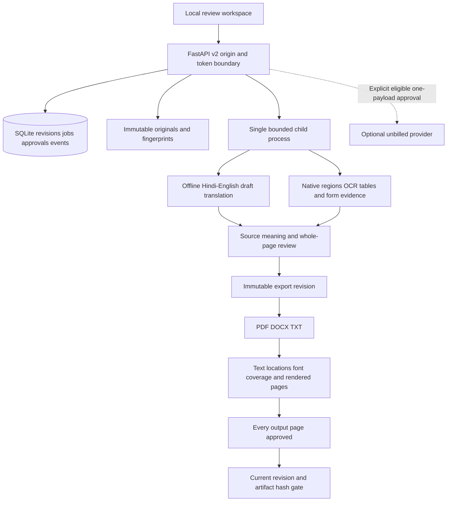
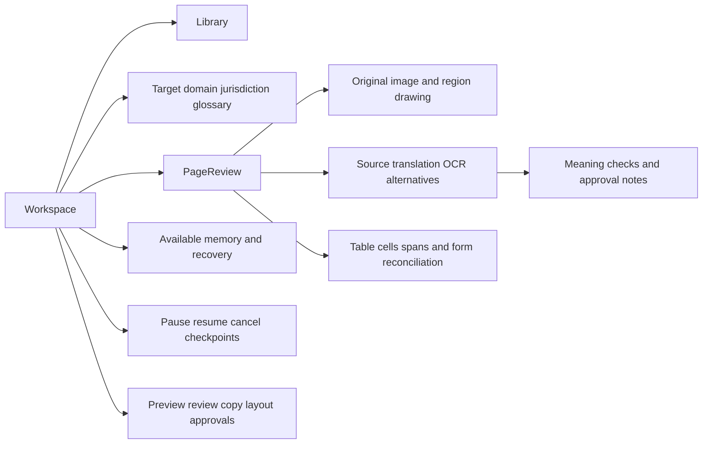

# PDF Reader - Development & Task Ledger

> **Last Updated**: 2026-09-26 (Asia/Calcutta)
> **Current Version / Milestone**: v0.5 manual table grids, export qualification 5, and verified form refresh
> **Status**: In Development; full revised plan not complete or release-qualified

## 1. Project Overview & Objectives

Personal Windows application for reading varied PDFs, contextual Hindi/English translation and reviewed exports. Preserve original bytes, expose uncertain/missing content, retain edits after interruption and require content plus layout approval. Target is the existing 8 GB computer, with configured limits of 500 MB/1,000 pages and one heavy worker. These limits are not measured production throughput guarantees.

Target users: the owner and bilingual reviewers. Local import, OCR, correction, review and export work after setup. Both public native OPUS-MT directions are installed and run offline as unapproved drafts. Runtime integration is tested; bilingual/legal quality is not certified. Cloud remains optional, separately approved, free-only and disabled without eligibility credentials. No universal accuracy or exact-replica claim.

Tech stack: React 18/TypeScript/Vite, plain CSS, FastAPI/Python 3.12.14, SQLite WAL/local artifacts, PyMuPDF 1.25.1, Tesseract Hindi/English, fpdf2 2.8.8/uharfbuzz 0.56.1, python-docx. CTranslate2 INT8/SentencePiece run the installed Marian draft models. Native ruled-table and AcroForm evidence/review are integrated. IndicTrans2 remains an optional unqualified adapter; Docling/Paddle are not integrated.

## 2. System Architecture & Flow Mapping

### 2.1 Data flow


### 2.2 UI hierarchy


### 2.3 Directory roles
```text
Start-Local.ps1 / Setup-Local.ps1    Local startup and pinned setup
backend/app/api/review_routes.py   Versioned endpoints and local boundary
backend/app/api/body_limit.py      Pre-parser streaming request limit
backend/app/core/review.py         Completeness/meaning approval rules
backend/app/infrastructure/        SQLite, native/OCR extraction, bounded workers
backend/app/services/              Jobs, local/cloud translation, export, backup
backend/tools/                    Restore and model-qualification CLIs
backend/tests/                    Offline rules, worker/API, fault injection
backend/requirements-local*.txt    Core direct pins and tested Python lock
backend/requirements-translation.txt  Optional runtime with pinned wheel hashes
backend/tools/install_marian.py    Explicit safe public model installer
backend/local-data/               Ignored original/state/artifacts; never commit
backend/models/                   Ignored OCR/model files; never commit secrets
frontend/src/ReviewWorkspace.tsx   Local UI (old hosted UI only explicit mode)
frontend/tests/                   Chrome workflow and portable synthetic fixture
docs/                             Operation, validation, dependencies, history
tools/prepare-vercel.ps1           Strict static-only staging; never deploy project root
frontend/launcher/                Separate public launcher entry (no document API client)
tmp/                              Ignored QA workspaces, captures and experiments
```

## 3. Environment & Configuration

Working interpreter: `backend/.venv-local/Scripts/python.exe` (Python 3.12.14). Old `.venv` and `.venv-repaired` refer to a missing interpreter. Node 20.5.1 and Chrome are installed. Tesseract executable: `C:/Program Files/Tesseract-OCR/tesseract.exe`; Hindi/English/OSD data is local under backend/models/tessdata. Nirmala is loaded from installed Windows fonts, not redistributed.

| Setting | Default / behavior |
|---|---|
| RUNTIME_MODE | local; only literal local/hosted accepted; typo prevents startup |
| DATA_DIR | backend/local-data via startup script |
| MODELS_DIR | backend/models via startup script |
| MAX_UPLOAD_BYTES / MAX_PAGES | 524288000 / 1000 |
| WORKER_MEMORY_MB | 3072 |
| MINIMUM_FREE_MEMORY_MB | 1024 |
| WORKER_TIMEOUT_SECONDS / MODEL_TIMEOUT_SECONDS | 90 / 300 |
| ALLOWED_ORIGINS | Explicit loopback UI origins |
| VITE_RUNTIME_MODE | Local UI unless explicitly hosted |
| GEMINI_API_KEY / GOOGLE_READONLY_ACCESS_TOKEN | Optional secrets; absent in this build |
| GOOGLE_PROJECT_NUMBER / CLOUD_POLICY_REVIEWED_ON | Required only for eligible approved cloud jobs |

Commands: root `./Start-Local.ps1`; backend `.venv-local/Scripts/python.exe -m pytest tests -q`; frontend `npm run build` and `npm run test:browser`. Browser test mutates synthetic documents; use REVIEW_URL for a separate QA server. Setup uses the full Python lock plus npm ci. See docs/LOCAL-DEVELOPMENT.md for model access, backup/restore and all operating instructions.

## 4. Work Tracking & Roadmap

### 4.1 Active Frontier
- [ ] Comprehensive end-to-end qualification cycle requested2026-09-23: expand cache/page coverage, API fault injection, backup/restore atomicity, live local-model/browser/export workflows, and delayed frontend-response tests. Preserve user data; use isolated QA directories and normal live-worker limits. Record passed, failed and blocked cases separately; do not claim universal accuracy.
- [x] Installed both public offline draft models; real three-page API workflows pass in each direction.
- [x] Native table adoption/approval/export and static form value/appearance reconciliation implemented and tested.
- [x] User-reported RAM pause explained and recovery verified: latest Indian Easements Act upload inspected successfully as 200 pages. UI now shows current/required RAM and pending page count.
- [x] Current backend suite:433 passed,3 skipped,6 dependency warnings on2026-09-24 in213.76seconds. Fifteen frontend helper tests and fifteen synthetic delayed-response/draft browser checks pass. This is regression evidence, not workload or bilingual qualification. Optional real-model tests were not rerun successfully in this cycle.
- [x] Historical 2026-09-20 browser verification:16 ordinary + 11 structure + 6 RAM-message + 10 real-model checks = 43 passed. Real-model UI used production 3 GB / 1 GB resource defaults and decoded export preview; current frontend build passed.

- [x] Explicit form-evidence preview/mapping/apply preserves edits and rejects stale/ambiguous mappings; 64 focused tests pass.
- [x] Export qualification 5 enforces form evidence plus strict table grid/membership validation; 84 focused manual/native-table/API/export tests pass.
- [x] Manual grids support uneven boundaries and merged cells, retain original recognition evidence, protect saved edits, and require explicit transcription and review.
- [x] Sanitized static Vercel launcher deployed and verified; local engine remains on this computer.
- [x] All three previously pending form-refresh browser checks passed under unchanged normal limits. This iteration has six live browser/API checks and 13 separate synthetic component checks.
- [x] Normal port8000 started with current tested source on2026-09-25 after confirming the previous process and listener had already stopped outside this iteration. Health and manual_tables capability verified. No blocked stop/restart was retried; original data retained.

### 4.2 Completed Milestones
- [x] Root tracker initialized before implementation; detailed history retained.
- [x] Repaired cache page loss, legacy span omission, destructive OCR cleanup, guessed numbering, false reverse-cache validation and stale editor responses.
- [x] Durable documents/pages/regions/jobs, revision guards, raw evidence, OCR alternatives and manual missing-region review.
- [x] Worker memory/time/cancellation limits, pre-parser upload limits, password/inspection failures and recoverable checkpoints.
- [x] Source/translation/completeness approvals, context/glossary invalidation, issue notes and target-language consistency.
- [x] Protected pending manual work and sibling approvals with fault-injection regressions.
- [x] Offline-only model adapter with exact token coverage and qualification-manifest checks; explicit missing-model response.
- [x] Readable and constrained faithful/companion PDF, DOCX/TXT review copies, per-occurrence output map, Hindi shaping/logical text, missing-font blocker and artifact hash final gate.
- [x] Explicit one-use cloud preview/approval and mocked free-only boundary tests; no live document transmission.
- [x] Local UI, browser edit recovery, decoded export previews, mobile layout and no external font/service requests.
- [x] Backup/restore, startup/setup scripts, dependency locks, operating and capability reports.
- [x] Backend:433passed/3intentionally skipped,2026-09-24; real-model pilot plus allocation handling previously passed7tests(72.90s), not rerun in the current resource-blocked cycle.
- [x] Frontend: production build and 16 ordinary + 11 table/form Chrome checks passed; screenshots visually inspected.

### 4.3 Backlog & Release Gates
- [ ] Reviewed 20-page feasibility pilot and bilingual meaning assessment; optional authorized IndicTrans2 upgrade with a pinned runtime.
- [ ] Docling/qualified Paddle fallback; splitting regions across table boundaries; correction of existing edited/adopted grids; cross-page table headers. Bounded manual grids for isolated untouched recognition regions are implemented.
- [ ] Cross-page paragraphs/footnotes, cross-page reading-order relationships, many-to-many alignment and book-level contextual translation.
- [ ] Rich structured exports and contents-page regeneration; broader renderer compatibility qualification.
- [ ] Separate 160-page development and unseen 400-page/80-document corpus, 500 translation segments per direction, competent human reviewers.
- [ ] Actual 1,000-page target-hardware resource/recovery qualification, complete offline installation bundle, signed installer and rollback/distribution review.

### 4.4 Known Limits
Opening Chrome reduced free memory below the production 1 GB reserve. Tiny-fixture browser tests use a separate workspace with 512 MB worker / 128 MB reserve; do not present them as target-workload qualification. Real form page OCR smoke test ran in 52.58 seconds, 39 regions, 33 alternatives, zero reported OCR errors and zero approvals; no accuracy was scored. Layout replacement blocks scans, forms, annotations and overflow pending their required implementation/review. DOCX/TXT are review copies. The local model path provides drafts, including known legal actor/currency mistranslations; review remains mandatory. Real inference needs the normal 3,072 MB cap; loading failed at artificial512/768 MB caps. See docs/IMPLEMENTATION-VALIDATION.md for precise capability boundaries.

## 5. Architectural Decision Records

- ADR-001: Local default and explicit runtime validation. Legacy automatic network routes are disabled locally. Missing local models cannot trigger cloud fallback.
- ADR-002: Preserve original bytes and raw extraction; edited transcription and translation are separate. Uncertainty cannot become a blank successful page.
- ADR-003: Revision-bound approvals and immutable exports. Material context changes invalidate dependent reviews; final PDF requires every layout page and unchanged artifact bytes.
- ADR-004: Single bounded child process and durable checkpoints. Cache eviction changes speed only. Parsing starts inside the worker; multipart spooling has its own byte boundary.
- ADR-005: PyMuPDF HTML output produced incorrect extracted Hindi despite correct pixels (also reproduced on candidate 1.28.2; not adopted). Use pinned fpdf2/HarfBuzz with per-line ActualText for secondary shaping glyphs and explicit font coverage checks. Render and extracted text remain separate checks. PDF.js 6.3.289 ignores ActualText on the measured fixture. Generated Hindi pages now use vector outlines plus a checked direct-Unicode invisible text layer; page appearance/content guards and PDF.js tests pass on the measured samples. This never alters uploaded originals.
- ADR-006: Unsupported layout structures fail visibly. Companion output preserves rasterized original appearances plus a separate translation; it is not exact translated layout or original-signature certification.
- ADR-007: Cloud is one exact approved payload, current source/context revision, explicitly public content and a freshly verified unbilled project. Account terms/free availability expire and require rechecking; no paid fallback.

- ADR-008: Public native CC-BY-4.0 OPUS models are an offline draft baseline. Installation checks hashes/provenance/runtime execution; it does not qualify translation quality. No downloaded preprocessing script is executed.
- ADR-009: Native table cells preserve grid/span relationships and require independent structural approval; form stored values and visible appearances remain separate evidence requiring reconciliation. Export verification version 5 prevents old artifacts from bypassing current form/grid gates.
- ADR-010: Manual grids archive explicitly replaced untouched recognition regions and detector proposals. New cells start unreadable, including apparent blanks. Crossing regions and saved edits are protected. Strict complete-grid/member checks apply to structural approval and export.

## 6. Iteration & Change History

The complete step-by-step entries, intermediate failures and fixes are preserved in docs/DEVELOPMENT-ITERATIONS.md. This table records the current outcome of each implementation group.

| Date | Iteration | Files / change | Verification |
|---|---|---|---|
| 2026-09-10 | Baseline | tracker, legacy document/reader/language services | Cache boundaries and preservation regressions pass |
| 2026-09-10 | Durable core | review.py, review_store.py, review_jobs.py | Revisions, approvals, restart/cancel/stale checkpoints pass |
| 2026-09-10 | Resource worker | structured_pdf.py, bounded_worker.py, worker.py | Real bounded job path, preflight/password/render pass |
| 2026-09-10 | OCR setup | Pinned local Hindi data, local eng/OSD manifest | Actual form page completed; quality not qualified |
| 2026-09-10 | Translation/cloud | local_translation.py, approved_cloud.py | Token coverage and mocked cloud boundaries pass; models absent |
| 2026-09-10 | API/backup | review_routes.py, review_backup.py | Fixed Windows handles and export INSERT; backup/restore and final gates pass |
| 2026-09-10 | Export Unicode | review_export.py, requirement pins | Fixed MuPDF glyph map, fpdf2 secondary glyph, missing-font fail-open; multipage Hindi passes |
| 2026-09-10 | Browser integration | ReviewWorkspace.tsx, reviewApi.ts, index.html | Same-origin, accessible labels, status refresh, unsaved recovery, decoded preview; 14 checks pass |
| 2026-09-10 | Independent audit | store/jobs/review/export/config plus regression files | Manual data retention, sibling/target invalidation, repeated clauses, invalid runtime pass |
| 2026-09-10 | Request boundary | body_limit.py, routes, test_request_limits.py | Declared/chunked oversize rejection, valid multipart pass |
| 2026-09-11 | Full verification | backend/tests; frontend/tests | 120 backend passed/1 skipped; frontend build/16 browser checks passed |
| 2026-09-11 | Reading order | store/routes/UI, test_reading_order.py | Revision-safe exact region permutation, evidence retention and approval invalidation; 11 regressions pass |
| 2026-09-11 | Hindi reader compatibility | compatible_pdf.py, review_export.py, verify-pdf-text.mjs | Tested vector appearance/direct-Unicode layer passes MuPDF and independent PDF.js checks; deletion/color/text mutations rejected |
| 2026-09-10 | Operations/handoff | Setup/Start scripts, tools, README, docs, full lock | pip check clean; precise release frontier documented |

| 2026-09-20 | Local model/structure integration | Marian installer/adapter, table/form review and export, browser fixtures | 283 backend passed; real model API pilot passed both directions; 27 browser checks passed |
| 2026-09-20 | RAM recovery | resources API, measured errors, MemoryStatus UI, pending-page label | 10 focused tests passed; real 200-page import recovered at1,239 MB available |

| 2026-09-21–22 | Form evidence refresh | Evidence-only worker, revision/fingerprint-bound preview, explicit one-to-one mapping, retained edits, UI controls | 64 focused tests; current full suite passes; new browser cases pending RAM |
| 2026-09-22 | Export audit correction | Verification version 4; old-v3 form inventory/mapping upgrade regressions | 26 focused checks; full 313 passed / 3 skipped |
| 2026-09-22 | Public deployment | Separate launcher, strict prebuilt staging, root deny-all upload policy, deployment/usage docs | Desktop/mobile, hashes, headers, negative routes, live public-to-local navigation passed |

## 7. Deployment Ledger

- Current runtime,2026-09-25: after the overnight interruption no listener existed on8000/8002/8012. Started owned QA8002 using its existing isolated tmp/e2e-20260924 data, verified restart recovery, then stopped only that owned QA session. Started Start-Local.ps1 normally on8000 (session86176, server PID19372). Health OK and structure.manual_tables=true; source qualification5 and frontend index-BFvMggxm.js/index-BPsUGhA9.css now active. Normal3,072/1,024MB limits unchanged. Revalidate PIDs before reuse. Earlier blocked stop/restart was not retried; its target process had already ceased independently. No deployment or user document edits.

- Current runtime update, 2026-09-23: normal8000 still has backend qualification4 loaded. Automatic approval review rejected the guarded restart before execution with only "blocked by policy"; no stop or restart happened. It serves the newly built index-2Y3l0H2S.js / index-CnDBlMYZ.css, but the manual-table API requires a user restart with Start-Local.ps1. Source qualification5 is tested. Existing user originals and state are unchanged. Prior PID25152/23256 identities were verified again; do not assume these IDs stay valid. Separate QA8001 (PID20124/session87514) tested the new API using only tmp/form-refresh-browser and normal resource limits. Static component8011 is stopped.

- Local application: http://127.0.0.1:8000, restarted 2026-09-22 after confirming no active jobs. Launcher PID 25152; Python server PID 23256. Verify identity before reusing recorded IDs. Logs: tmp/local-server-20260922.stdout.log and stderr.log. Frontend index-B33x3uyZ.js; export qualification 4. Original data stays in backend/local-data. Normal limits remain 3,072 MB worker / 1,024 MB free-RAM reserve. Separate QA8001 and static8010 servers stopped.
- Public launcher: https://book-pdf-reader-studio.vercel.app. Production deployment dpl_7TNN8QT6d9EvANDbWpmzFA1YoiRX; immutable URL https://book-pdf-reader-studio-pojxd1dut-shresth-singhs-projects.vercel.app. Deployed with existing authenticated Vercel CLI on 2026-09-22. Static launcher only; not a hosted PDF processing service.
- Protected preview: https://book-pdf-reader-studio-bkxode9uz-shresth-singhs-projects.vercel.app, dpl_9xrHDq1U2dXhgk8mMDR1iuEHReUi. Authenticated CLI verified assets. Preview HTML includes Vercel's toolbar injection, blocked by the site's CSP; unauthenticated production HTML matches exactly.
- Stage: tmp/vercel-launcher-31f3083add104e3cb0c1a28de56007e2; adjacent manifest has three files, 153,243 bytes, SHA-256 hashes. Launcher JS index-CfgdTY5Y.js and CSS index-BRXG-BBW.css. Public HTML/assets match hashes; all five tested API/private-looking paths return 404. Report: docs/measurements/2026-09-22-vercel-launcher.json.
- Do not deploy the repository root. tools/prepare-vercel.ps1 copies only bounded allowlisted static assets into a fresh Build Output API stage. Root .vercelignore denies everything except a deliberately failing root deployment config. No PDFs, SQLite, models, backups, logs or credentials uploaded. No Git commit/push made. Previous production dpl_2kyk9bUVfLWBg2zQbSaMpJomSJMV was the legacy three-service app; do not roll back to that architecture automatically.

## 8. Agent Handoff & Continuity Guide

### 2026-09-26 — Bounded Vercel Queue subscriber

- Added `backend/app/hosting/queue_worker.py`: official `vercel.queue` subscriber for `pdf-review-jobs`, one concurrent invocation, ten delivery attempts and 60-second retry delay. It validates job/cursor/attempt, runs one page in a request-owned workspace, conditionally commits the page plus checkpoint, then publishes continuation with a deterministic idempotency key. Duplicate/stale deliveries dispatch only the current queued checkpoint. CAS conflicts propagate for platform retry; no daemon, public callback route or import-time sends were added.
- `backend/app/services/review_jobs.py` now accepts optional `run(job, max_units=1)` and yields unfinished jobs as queued. Default local behavior remains full-job execution. Existing page revision, cancellation, extraction protection and pause-on-worker-error rules remain in that shared runner.
- Integration: declare `[[tool.vercel.subscribers]]` with `entrypoint="app.hosting.queue_worker:process_message"`, and invoke `await dispatch_pending(workspace.store)` only after successful API workspace commit. The worker uses `runtime.HostedWorker(settings)` and `runtime.hosted_settings(root)`. Queue-only trigger authentication is supplied by the SDK/platform. At platform retry exhaustion or message expiry, saved queued work remains recoverable by pause/resume, which advances its attempt key.
- API shape checked against Vercel's official SDK README and source (`https://github.com/vercel/vercel-py/tree/main/src/vercel-queue`). No tests/builds were run, following the user's current instruction. This records implemented wiring pending deployment, not live Queue availability or processing qualification.

### Current handoff — 2026-09-26: all-Vercel migration

2026-09-26 frontend/API integration: ReviewWorkspace now accepts local/vercel runtime, uses direct signed private uploads on Vercel, communicates the64MB hosted limit, and polls hosted jobs every20seconds. Added hostedUpload.ts. Runtime adds packaged Tesseract PATH; Blob snapshot publication retains the committed artifact mapping. Login frontend from delegated agent integrated by prop. No new tests or build yet; direct signed upload/download contract and packaging under review. Local multipart upload and polling remain unchanged.

2026-09-26 implementation iteration: added hosted owner authentication, encrypted PDF-password persistence, request-isolated SQLite/Blob conditional publication, lazy artifact hydration with integrity checks, Vercel-only worker budgets, direct-upload ticket endpoints and durable API wrapper. Files: backend/app/hosting/auth.py, workspace.py, runtime.py, app.py. Hosted defaults64MB/PDF,1000pages,1280MB child budget,240MB hydrated-artifact budget are explicit platform limits; local500MB/3072MB limits unchanged. Work is not deployed or verified yet. Queue subscriber, Blob signed URL contracts, native Linux packaging, frontend hosted labels/upload, auth credentials and deployment remain in progress. Existing public launcher is unchanged. No new regression tests run per latest user instruction.

User explicitly requests Vercel for the backend as well and has removed the earlier requirement to run further tests before deployment. Implementing a separate hosted runtime: authenticated private workspace, Blob immutable artifacts and conditional metadata snapshots, bounded queue units, and sanitized Linux deployment packaging. Existing local runtime and user originals remain untouched. This supersedes the earlier requirement for a separate backend hosting account; do not ask for that account. The production URL still serves the static launcher until an actual full deployment succeeds. No new regression suite has run; compile/build/deployment diagnostics remain necessary. Agents own Blob adapter, hosted login frontend, and packaging; root owns durable workspace, authentication, API/queue integration. Resume from backend/app/hosting and hosting/vercel. No public data or paid services are authorized; only deploy allowlisted source/public model assets.

### 2026-09-26 — Hosted frontend authentication shell

- Added `frontend/src/HostedWorkspace.tsx` and `hosted.css`: an owner password sign-in using same-origin `/api/auth/session`, `/api/auth/login` and `/api/auth/logout`; authenticated users enter the full `ReviewWorkspace` with `runtime="vercel"`. Credentials are not stored in browser storage or URLs. The server must establish and validate the secure session cookie.
- `frontend/src/main.tsx` selects this shell only with `VITE_RUNTIME_MODE=vercel`; existing local and legacy hosted entry points remain available. `reviewApi.ts` resets its cached mutation token after 401/403 and auth transitions; a hosted 401 returns to sign-in with an expiry notice.
- Hosted UI describes Vercel processing/storage, browser draft storage, free-plan limits and required review. It does not imply local processing or certified accuracy. Root implementation must add the runtime prop and production auth/storage/backend routes before deployment.
- Per the user's latest instruction, no tests or builds were run by this frontend subtask. Build, deployment and backend/upload integration remain with the coordinating agent. This entry records implementation, not successful production qualification.

### Current handoff — 2026-09-25

2026-09-25 latest instruction supersedes the previous test gate: user requests full project deployment with no further testing. No tests were run. Parent and independent read-only review confirmed plain free Vercel cannot run this current backend unchanged: local/hosted API guards, SQLite/filesystem persistence, process-resident job runner, process-local sessions/passwords/gate, native runtime and Windows wheel hashes require a hosting migration. Official current Vercel docs confirm2GB/300sHobby,4.5MBrequest/response and500MBtemporary filesystem limits. Vercel CLI account/project access works; env metadata inspected without pulling secret values. No persistent backend target/access exists in the inspected deployment setup. Full deployment requires one authenticated persistent backend plus Vercel review UI, or a larger serverless redesign. Free-only remains in force; no paid account/resource, uploads or redeployment authorized by inference. Updated docs/DEPLOYMENT.md with concrete architecture and blockers. Next required input is backend hosting target/access; do not keep citing unrun tests as the deployment blocker, and do not relabel the static launcher as full deployment.

2026-09-25 conditional deployment request: user requested free Vercel deployment only if all tests pass. Rechecked the qualification report:433 backend passes/3 optional skips, but fresh successful OCR/model/final-export workflow remains blocked and release_qualified=false. Normal8000 currently reports191MB available against1,024MB required. Existing public static launcher returnedHTTP200 with its expected asset reference. No new deployment was made because the requested test condition is not satisfied. Provide the existing launcher link with its local-server limitation; do not present it as a hosted PDF engine or completed release.

2026-09-25 report/operations iteration: refreshed README, implementation validation, local-development instructions and current tracker/handoff, retaining dated history. Added docs/measurements/2026-09-25-expanded-qualification.json with exact backend/helper/browser/live scope and explicit blocked cases. Normal8000 health/manual-table capability verified after startup; no live model/worker success claim. No source changes after the passing integrated suite/build. No commits or deployment performed.

This update supersedes earlier runtime/test summaries below. The current request is exhaustive end-to-end testing with fixes, not premature manual-test handoff. Latest integrated suite:433passed/3skipped/6warnings in213.76s (tmp/backend-tests-expanded-20260924.xml/.log). Frontend build passes139modules; fifteen Node draft-helper tests and fifteen actual-React/synthetic-transport browser checks pass. Full evidence is docs/measurements/2026-09-25-expanded-qualification.json. pip check passes. Existing Python/Browserslist/Tailwind warnings remain.

Fixed reproduced failures: partial restore publication (review_backup.py now verifies/rebases in a sibling staging workspace then renames atomically); failed export worker/hash/INSERT/event/commit orphan outputs (review_routes.py deletes only request-owned outputs until commit; post-commit response errors retain the artifact); delayed workspace polls replacing a different page/document or a newer edit; partial region-draft recovery; unprotected meaning/completeness notes. Frontend uses active-view/refresh sequence/edit generation guards and serialized polling, disables edits during mutations, validates eight editable draft fields, and stores revision-bound review notes. Files: ReviewWorkspace.tsx, regionDraft.ts, useReviewNotes.ts, review.css. Browser drafts remain outside server backups. Native unload and simultaneous-tab draft conflicts are not independently qualified.

New regressions: test_cache_qualification.py18, test_e2e_boundary_audit.py19, test_export_registration.py6, frontend/tests/region-draft.test.ts15. Actual synthetic native512/513/740/1000page reads survive512entrycache eviction and reverse reads;1001rejected unchanged. This is not an actual1000pageOCR/translation workload. Delayed-browser harness is frontend/tests/workspace-race-harness.tsx with serve-race-harness.py on8012; compiled tmp/workspace-race-qa assets. It injects transport delays/approval errors/storage quota failures without workers or real documents. Fixture tabs/server were closed.

Fresh live workflow blocked: normal3,072MB cap/1,024MB reserve retained. QA document3b3c2d4a-041e-4942-9bfb-34cf0be6f030 in tmp/e2e-20260924 paused inspection with869MB available; retry after actual process restart on2026-09-25 returned503 low_memory at368MB. Original SHA, revision and pending state survived. Browser correctly showed pending pages/current RAM, actionable retry and disabled export. Actual HTTP backup/checksums/new-directory restore/auth boundary passed. Details tmp/live-qualification-20260924.json; backup and restored target under tmp/live-qualification-*. Do not count fresh OCR/model/successful-export tests as passed. Resume this exact isolated document when normal RAM permits; do not lower guards or close unrelated apps.

Normal8000 was already stopped when the2026-09-25 continuation began (no listener on8000/8002/8012). After QA cleanup started Start-Local.ps1 on8000, session86176/PID19372; health and manual_tables capability verified. This loads current backend5 and frontend. No attempt to stop the formerly blocked process was made. User originals/edits were not changed. The public Vercel static launcher is unchanged; no upload/deploy/commit/push. Earlier records saying normal8000 still runs backend4 are historical only.

Remaining: fresh resource-available browser/API/model/final-PDF workflow, actual long-document qualification, independent bilingual20/160/400page datasets/review, and the outstanding plan capabilities listed in4.3. Do not call the project complete or universally accurate. Do not ask the user to do manual testing as a substitute for the blocked agent checks.

### Previous handoff — 2026-09-23

2026-09-23 comprehensive testing cycle started at the user's explicit request. Cache agent owns new test_cache_qualification.py (real synthetic native512/513/740/1000page coverage and1001rejection, cache isolation/eviction/retry); API agent owns review_backup.py and export-failure cleanup in review_routes.py plus new test_e2e_boundary_audit.py. Parent owns frontend race tests/fixes and live CUA/API qualification. Do not run heavyweight jobs concurrently. Available RAM initially900MB, below normal1,024MB scheduling reserve; no thresholds changed. Previously blocked normal8000 restart is not retried. New isolated QA process may be started/stopped through its own tool session. Two discovered failure cases are partial restore destination after copy failure and orphan export output after definite worker failure; regression/fix work is in progress.

Final cleanup, 2026-09-23: temporary QA servers on ports 8001 and 8011 were stopped through their owned foreground sessions; temporary browser tabs were closed. Only normal port 8000 remains listening (server PID 23256, identity checked). Health returns OK. Available RAM was 925 MB against the unchanged 1,024 MB reserve, so heavy work currently pauses. The normal server remains on its previously loaded backend; the updated frontend explains the needed restart. Final frontend: index-CprxwxlR.js. Git diff whitespace checks passed, with only repository line-ending notices. User documents were not modified. No commits, pushes, new cloud requests or deployments were performed in this iteration.

FINAL VERIFIED UPDATE:390backend tests passed/3skipped/6warnings in252.02s after all preservation edits (tmp/backend-tests-preservation-20260923.xml/.log). Frontend137module build passed, index-CprxwxlR.js / index-CnDBlMYZ.css. Eight new draft-recovery/navigation checks and two compatibility checks passed; report docs/measurements/2026-09-23-draft-preservation.json. This supersedes the earlier361 counts and frontend hashes below. Original13component +6live checks remain dated2026-09-22. No further source edits are pending.

Preservation changes: manual and native grid adoption now reject saved language/disposition/contains_text/reason/kind/check-acknowledgement/form/cell-marker work. Native regression file adds22cases; manual protections add7cases. Unfinished ManualTableEditor drafts persist per document/page in browser storage with captured revision, bounded200KB recovery data, geometry, merges, selected source IDs and note. Invalid numeric inputs stay invalid. Workspace guards page/document/import navigation and unload; explicit discard/success clears the draft. Browser drafts are not in server backups. Storage errors show warnings; simultaneous tabs and native unload-dialog behavior remain unqualified. A planned additional2page fixture was not imported because normal RAM was702MB; no guard lowered.

Loaded-code boundary: normal8000 still has older backend version4; restart was denied by automatic approval review. The new UI checks structure.manual_tables and now shows clear save/restart guidance on8000 rather than offering an unsupported action. QA8001 advertised the new capability and successfully displayed the editor. API/frontend compatibility does not update a loaded Python process; the user must restart their normal local server before using new backend functions. Final QA cleanup appears at the end of this file.

2026-09-23 preservation audit: independent review found native adoption could replace saved language/disposition/contains-text/reason choices, and unfinished manual grids were lost during navigation/reload. Native fix/regressions delegated with file ownership. Parent added revision-bound browser draft persistence, explicit discard, page/document/import guards and unload protection for manual grids (ManualTableEditor.tsx, ReviewWorkspace.tsx). Restored drafts retain stale-revision blocking and invalid numeric inputs. Build/browser regressions pending. Earlier capability-only full suite completed361passed/3skipped/6warnings in617.04s; this new preservation change requires its own focused/full verification.

Draft recovery follow-up: enforce a200KB browser draft limit with a visible warning, remove persisted work after explicitly clearing all fields, and enable persistence in the synthetic component harness for reload checks. No document data or API revision changed by browser drafts.

2026-09-23 preservation parity: extended the same saved semantic-kind/check-acknowledgement/incomplete-form/cell-marker protection to manual-table creation and its frontend precheck. Added7atomic-rejection regressions in test_manual_table.py. Native adoption agent reported44focused cases passed, including22new cases. Remaining verification: stable full suite, draft recovery and navigation browser checks; no further backend changes planned unless they expose a defect.

2026-09-23 compatibility iteration: added an explicit manual_tables capability and gated the new table editor on it. An older loaded server now gets a save/restart instruction instead of an unsupported table action. Files: review_routes.py, reviewApi.ts, ReviewWorkspace.tsx, test_manual_table_workflow.py. API assertion, frontend build and live old/new-server UI verification pending. Normal8000 restart remains blocked; its data is unchanged.

2026-09-23 verification continuation: rebuilding the frontend and rerunning the full backend suite after the compatibility guard (sessions37891/48330; report tmp/backend-tests-v5-compat-20260923.xml/.log). Added restart/capability instructions to LOCAL-DEVELOPMENT.md and a precise running-code limitation to IMPLEMENTATION-VALIDATION.md. Previous live QA8001 was stopped through its owned foreground session before compatibility verification. A separate read-only review of grid preservation/geometry is in progress; no broad re-testing beyond this change is planned if these checks pass.

This subsection supersedes the dated handoffs below, which are retained as history. The complete plan is still in development; no universal accuracy or legal-correctness claim.

Manual table grids are implemented in core/manual_table.py, structure_review.py, infrastructure/review_store.py, api/review_routes.py, services/table_export.py, ManualTableEditor.tsx and TableReviewPanel.tsx. The revision-bound API accepts finite PDF-point boundaries, zero-based merged spans, exact replacement IDs, an optional unadopted proposal ID and reviewer note. Limits:40rows/20columns/200positions. All intersecting regions must be fully contained and untouched native/image-OCR evidence. Crossing regions, saved edits, forms, adopted cells and conflicting proposals are refused. Original regions/proposals are archived. New cells are unreadable; no OCR or automatic text distribution occurs. Cell/structure/completeness reviews remain separate. Full-page scans crossing a smaller table need a future splitting workflow; edited/adopted grid correction remains incomplete.

PDF_VERIFICATION_VERSION is5. Strict complete-grid, unique-cell, span, bounds and one-to-one active-region checks apply before approval/export. Old artifacts including version4 require regeneration; never merely alter their saved qualification number.

Evidence:361backend tests passed/3intentional skips/6warnings in211.77s (tmp/backend-tests-v5-final.xml/.log). Focused84passed in35.96s (tmp/manual-grid-tests-final.xml/.log). Frontend build passed137modules, index-2Y3l0H2S.js. Thirteen browser component checks used an in-memory fixture with no API/worker. Six additional live browser/API checks used normal3,072MB worker/1,024MB reserve: all three previously pending form-refresh checks now pass, plus manual-grid creation, archived/unresolved-cell checks and preserved separate form review. Available memory before preview was1,236MB. Reports: docs/measurements/2026-09-22-structure-components.json and 2026-09-22-structure-live.json. No browser warnings/errors. Historical43browser checks are separate dated evidence, not rerun today.

Normal8000 remains on the old loaded backend because automatic approval review blocked the guarded restart, giving only "blocked by policy". Source/frontend are newer, so the manual-table API is not available on8000 until a user restart. Do not retry that blocked restart through another mechanism. User data is unchanged; latest normal book3a293bb1-17f8-4539-8554-7b6532b92143 had200pages/revision6 and3extractedpages. User edits may occur independently. Do not delete/recreate uploads or close unrelated applications. Separate live QA used tmp/form-refresh-browser only. Final QA cleanup is recorded below.

Public static launcher remains https://book-pdf-reader-studio.vercel.app (dpl_7TNN8QT6d9EvANDbWpmzFA1YoiRX), requiring the same computer's local server. No new deployment is needed for local controls; no PDFs/models/SQLite were uploaded. Follow tools/prepare-vercel.ps1, never deploy the repository root.

RAM pauses are recoverable scheduling guards based on available system memory, not uploaded size. Normal limits are unchanged. On2026-09-23 memory again fluctuated around1,000MB, below the1,024MB reserve. Real QA passed when RAM recovered. Local OPUS drafts retain known legal actor/currency errors and require bilingual review; IndicTrans2 is optional/gated/uninstalled, Docling/Paddle absent.

Next: user restart to load the tested API; table-region splitting and edited-grid correction; cross-page paragraphs/footnotes/context/alignment; rich exports/contents regeneration;20-page feasibility and independent160/400-page bilingual corpus review; actual1,000-page workload and offline installer/signing/rollback. Use backend/.venv-local. No automatic cloud fallback. No commit/push made.

2026-09-23 documentation iteration: updated current roadmap, runtime ledger and this handoff using a scoped patch that preserves previous history. A bulk rewrite/archive shell command was rejected before execution; no history was removed. README, usage, deployment and validation documents already record current manual-grid behavior and tests.

2026-09-24 frontend race audit: added an isolated synthetic transport harness around the actual ReviewWorkspace and an owned loopback fixture server. It can hold page and save responses while normal controls are used, with no real PDF/model/user data access. Reproducing delayed-poll edit loss and cross-document races before implementing guards. Files: frontend/tests/workspace-race-harness.tsx, frontend/tests/serve-race-harness.py. Integrated backend suite and live normal-resource qualification remain pending.

2026-09-24 frontend reproduction and fix: browser fixture demonstrated Beta.pdf displaying Alpha source after release of an old page response, and an in-flight poll clearing newly typed translation while leaving the unsaved indicator. Added active document/page and refresh sequence guards, post-await edit-generation checks, polling exclusion during mutations, and disabled editing while saves/approvals run. Region drafts restore only validated editable fields, including language/kind/disposition/text-presence; current server evidence and approvals are retained. Added browser-storage failure message. Files: ReviewWorkspace.tsx, review.css, regionDraft.ts. Post-fix regression, note-draft protection and final build still pending.

2026-09-24 review-note preservation: meaning and completeness notes now have validated, revision-bound browser drafts, recovery/stale messages, explicit discard, and clearing only after the corresponding approval succeeds. A browser-storage failure blocks leaving the current document/region; all notes are disabled while mutations run. Polls are serialized to avoid overlapping refreshes, and all direct structure/form mutations share refresh invalidation. Export selection/navigation are disabled during pending approvals. Files: useReviewNotes.ts, ReviewWorkspace.tsx. Validation pending; these browser drafts remain outside server backups.

2026-09-24 frontend regression progress: fixed cross-document delayed responses, in-flight poll edit overwrite and disabled editing during held saves verified in the real workspace component with synthetic transport. A separate browser tab recovered heading/language/disposition/false text-presence and translation; discard restored current server state. Extended harness with approval failure and storage quota injection plus meaning/completeness note fixtures. These are frontend fault-injection checks, separate from real-worker qualification. Build passed139modules (index-BFvMggxm.js); full expanded backend suite running.

### Earlier handoffs and development history

2026-09-26 Vercel packaging assembly complete: added hosting/vercel/build_native.py, README and tools/prepare-vercel-full.ps1. The script stages only backend Python code, built UI, exact manifest-checked converted public Marian models, and three OCR language packs; it excludes user PDFs, databases, backups, environments, archives and linked paths, and removes personal absolute paths from the staged tessdata manifest. The build hook compiles immutable official Leptonica/Tesseract revisions in temporary build storage, bundles native dependencies/licenses and pinned SIL-OFL Noto Devanagari. All assembly is fail-closed. No build, tests, staging execution or deployment was run by this agent. Section 8 supplement: parent must enable Fluid/large functions, provide hosted persistence/auth secrets, prepend vendor/native/bin to PATH before readers import, build hosted UI, then deploy only the returned stage. Native build compatibility and actual cloud behavior are unqualified; direct pins are not a full transitive lock.

2026-09-26 Vercel packaging iteration: added hosting/vercel templates for a Python 3.12 FastAPI entrypoint plus a separately discovered Python Queues subscriber, Node 24 project metadata, 300-second function limits and direct runtime pins matching the installed Marian model manifests. Official PyPI Linux-wheel hashes are recorded as provenance; this is not a complete transitive lock or Linux qualification. Native OCR/font build hook and strict sanitized staging script are being implemented. No tests, build, deployment, model downloads, user-data upload, or local-server change was performed. Section 8 supplement: parent owns hosted persistence/authentication/queue runtime and frontend build; packaging must fail if native OCR or licensed Hindi font cannot be assembled.

Current mental model: local original/revision/checkpoint/review foundation, working offline Hindi-English draft inference, native ruled-table cells/spans, form stored-value/appearance reconciliation and explicit legacy form-evidence refresh. Review approvals are separate and revision-bound. Uncertainty stays visible. PDF_VERIFICATION_VERSION is now4; old exports including v3 with saved layout approvals must be regenerated for final approval. Do not equate native OPUS draft models with whole-book contextual translation or legally correct meaning.

New form workflow: bounded inspect_forms worker checks original SHA/page/coordinates and complete widget inventory. Store creates a one-use preview without content changes. Explicit complete one-to-one mappings and note are required; apply verifies original bytes again plus page/document revisions. Existing source/translation/raw/note/geometry/IDs/order survive; new fields stay unresolved. Identical refresh is a no-op for content revisions/approvals. Material refresh clears dependent approvals conservatively. Read core/form_refresh.py, infrastructure/review_store.py, api/review_routes.py, frontend/src/FormEvidenceReview.tsx and tests/test_form_refresh.py first.

Latest full backend evidence:313passed/3intentional skips/6warnings, tmp/backend-tests-v4-20260921.xml/.log (completed 2026-09-22). Elapsed46630.63s spans host suspensions; not a speed measurement. Earlier full run overlapped a version edit and failed3cases due old parent/new child constants; stable-version full rerun passed. Focused form64 and export audit26 pass. Historical browser43 passes are dated2026-09-20. Three newly added refresh browser checks have NOT passed because normal-resource import paused at lowRAM. An attempt to lower only isolated QA budgets was rejected before execution by automatic approval review, with no detailed reason; no resource thresholds were changed. Resume these UI tests when RAM is available; do not bypass the guard.

Frontend normal build and separate launcher build pass. Launcher desktop and390px mobile rendered without overflow; help works; no console warnings/errors. Production HTML/JS/CSS return200 with exact manifest hashes and CSP; API/data/model/env probes404. Public Open local workspace button successfully opened healthy8000app in another tab. Public and local tabs left available. Deployment is a static launch/setup page requiring the server on the same computer. The full product has not passed release gates.

The RAM message is a recoverable scheduling pause, not evidence of PDF corruption. UI shows actual/required RAM and pending inspection page count. Original imports remain. Latest book3a293bb1-17f8-4539-8554-7b6532b92143 still has200pages; most recent read showed statusready/revision6. User edits may continue independently; do not recreate, delete or reset uploads. No active jobs existed before restarting8000. Production 3,072/1,024 limits remain unchanged. Do not close unrelated applications.

Known quality: Hindi debtor/100rupees became “We need to give a hundred bucks.” Fact/number checks flag it; no legal qualification. Both native OPUS archives are CC-BY-4.0; retain attribution. IndicTrans2 remains gated/uninstalled; Docling/Paddle absent. Real-model opt-in API/browser tests passed previously and are not rerun for this form-only change. Use backend/.venv-local, RUN_LOCAL_MODEL_TESTS=1 only for deliberate model qualification; no online fallback. Use per-command git -c safe.directory='C:/Users/SHRESTH SINGH/Projects/PDF Reader', not global configuration.

Next: finish resource-available new form-browser checks, ambiguous/scanned table correction, cross-page paragraphs/footnotes/context/alignment, contents/structured exports; conduct20-page feasibility and independent160/400-page bilingual corpora; qualify actual1,000-page workload; finish offline installer/signing/rollback. See docs/IMPLEMENTATION-VALIDATION.md for exact boundaries and docs/DEPLOYMENT.md for safe static deployment. The full requested project is still in development. No100% or all-cases claims.

Detailed previous handoffs, iterations and intermediate failures are retained in docs/DEVELOPMENT-ITERATIONS.md. This Section8 supersedes stale dated runtime/version statements there.

2026-09-22 handoff finalized: current tracker Sections4/7/8, README and validation record updated for313passed/3skipped, form refresh, export version4, deployed static launcher and pending resource-blocked UI checks. Detailed interim handoffs archived without deletion. Final local health checked; no commits/push or additional document mutations.

2026-09-22 manual table iteration: added strict versioned API request schema and revision-checked store transaction for explicitly defined table grids, conservative approval invalidation and archived source audit. Existing production server remains on last tested code while implementation proceeds. Files:review_routes.py,review_store.py,reviewApi.ts. Coregeometry+puretests and separate UIcomponent delegated. Section8 nextfrontier is this workflow; pending formbrowserchecks stillresourceblocked (898MBfree atstart). New cells will remain unreadable until manually transcribed or confirmed blank; existing edits and crossing/form/table regions will be protected.

2026-09-22 manual-grid core integration: agent produced core/manual_table.py before its usage limit; parent continuing remaining UI/tests. Added strict saved-grid validation used by table blockers, structural approval and export (cell uniqueness, exactmembership, completegrid, spans, coordinates). Export qualification bumped to5 so oldcachedblockers cannot bypass strictertablechecks. Manualreplacement rejects recognizerregionedits/approvals/dispositions and boundarycrossings, preservesoriginalsnapshots, newcellsunresolved. Files:manual_table.py,structure_review.py,table_export.py,review_export.py. Testsnotyetcompleted; production remains priorversion4untilverified.

2026-09-22 manual-grid UI added: original-page overlay with drag/numericbounds, unequalpercentageboundaries, optionalmergedcells, explicitoldregioncheckboxes, protected/cross-boundarywarnings, revision-bound draft and preserved failed submissions. Newgridrequirestranscription/review, no OCRcall. Files:ManualTableEditor.tsx,manual-table.css. Parentintegration, archivedsourceview and tests next. Delegated agents exhausted their limits; parent continuing locally.

2026-09-22 manual table UI connected to revision-bound API. Table panel distinguishes unresolved cells from confirmed blanks and exposes paginated preserved raw extraction/OCR alternatives. Pending text edits are retained across response callbacks. Files:ReviewWorkspace.tsx,TableReviewPanel.tsx,structure_review.py. Current code stillunderverification; no productionrestartyet.


2026-09-22 manual table regressions added: atomicgeometry/merge/mappingfailures, editedsourceprotection, scannedtableevidenceretention, ambiguousproposalarchive, duplicate/incorrectsavedgridchecks, APIrevision/auth/schema, contextinvalidation and reviewedPDF/DOCXcelloutput withoutduplicatearchivedtext. Files:test_manual_table.py,test_manual_table_workflow.py. Focused tests and frontendbuild running.

2026-09-22 focusedtestresult:83passed/1failed because strictertablevalidation changed an established missing-cell errorcode. Moved structuralvalidation after existing order/membership refusal to preserve APIbehavior; rerunningfocusedtests. Frontendbuildpassed137modules. Added synthetic component-only browserharness (no PDF/APIworker or resourceoverride) to check controlstates/failure/stalerevision behavior while machineRAMremainslow. This is separate from realworkerend-to-endqualification.

2026-09-22 APIhardening: manual-grid boundaries nowstrictfinite numericvalues, rejectingboolean/stringcoercion beforecorevalidation; regressionincludesbooleanedgepayload. RerunningfocusedAPI/core/exporttests, nootherqualificationrulechangesplanneduntilsuitefinishes.

2026-09-22 focused verification passed:84manual/native-table/API/export/version tests,6existingdependencywarnings,35.96s. Frontendproductionbuildpassed index-idb07bRc.js. Syntheticbrowser check confirmed staledraftcannotpublish. Running fullbackend suite against stablequalification5 while finishing browsercomponentfailure/mappingchecks.

2026-09-22 browser component evidence:11syntheticbrowserchecks passed (manualgrid stale/geometry/mapping/merge/failure/recovery; form visible/storedvalues, unmapped/stale/failure/recovery). No consolewarnings/errors. No PDFworker invoked and noresourceguardchanged; realworker formbrowserchecks stillpending. Added explicitaccessible formselectlabel afterlocator mismatch; fixturesubmittedJSON wraps forsmallviewports. Files:FormEvidenceReview.tsx,structure-component-harness.tsx. Fullbackendrun must execute frombackend; initialrootlaunch failed collection only, correctedrun underbackendinprogress.

2026-09-22 stable manual-grid verification: full backend suite passed 361 tests, 3 intentional skips, 6 dependency warnings in 211.77 seconds (tmp/backend-tests-v5-final.xml/.log). All 84 focused checks passed. Frontend production build passed with index-2Y3l0H2S.js / index-CnDBlMYZ.css. Thirteen synthetic component checks passed, including pointer geometry and 390px mobile layout; no browser warnings/errors. This component fixture invokes no PDF worker and is separate from end-to-end qualification. Attempted normal server restart was rejected before execution by automatic approval review with only "blocked by policy". Existing 8000 server remains on export version 4 with the newest static frontend; manual-table API requires a user restart. No thresholds or user data were changed. A separate normal-limit QA server is running on 8001 (session 87514, PID 20124), using only tmp/form-refresh-browser to retry pending form checks as RAM permits.

2026-09-22 documentation iteration: README, local usage, capability report and deployment documentation now describe manual-grid limits, original-evidence retention, mandatory cell/structure review, version 5 regeneration and 361 backend/13 component results. Separate QA8001 successfully recovered its previously paused synthetic import under unchanged 3,072/1,024 MB limits; extraction is in progress. Normal8000 remains running on the prior loaded backend because restart was policy-blocked. Source and static build are version5-ready; do not claim the new API is live on8000 until a user restart is verified.

2026-09-23 native table review protection: after the shared compatibility suite completed (361 passed, 3 skipped), tightened native table adoption so unchanged text cannot conceal saved language, disposition, text-presence, reason, semantic-kind, check acknowledgement, or form/table state. Such source regions stay active and the operation fails atomically; untouched native paragraph adoption is retained. Files: backend/app/core/structure_review.py, backend/tests/test_native_table_edit_protection.py, task.md. New focused regressions pending; parent owns UI draft recovery and the main handoff refresh.

2026-09-23 native table protection verified: all 44 focused regressions passed in 9.91 seconds (22 new review-choice/atomicity/success cases plus 22 existing native table review tests), with six existing dependency warnings. No original files were changed and no server or browser was restarted. Files: backend/app/core/structure_review.py, backend/tests/test_native_table_edit_protection.py, task.md. The native extractor currently emits paragraph regions; a saved different semantic kind is therefore protected as an explicit review choice. Ready for parent integration and final handoff update.

### 2026-09-23 — API/recovery boundary audit regression draft
- Added backend/tests/test_e2e_boundary_audit.py with temporary-workspace transaction interruption, checkpoint resume, cancelled/recovered late result, restore integrity/path traversal, API host/origin/token, and failed export cleanup checks. No user files or live server were touched; workers are fault-injection stand-ins and resource settings are unchanged.
- Found restore copy publication and failed export artifact cleanup candidates; initial focused verification follows. Production fixes are being coordinated with the parent agent.
- Section 8 handoff supplement: this audit is scoped to durable state and API boundaries, not OCR/translation quality or a real worker end-to-end claim.

2026-09-23 cache qualification iteration: added backend/tests/test_cache_qualification.py covering real synthetic native PDFs at 512/513/740/1000 pages, explicit 1001-page rejection with original retention, durable inventory reopen, bounded LRU/TTL/isolation/concurrent eviction, partial failures and retries, and stale context/glossary/job-attempt publication. Tests run only in pytest temporary directories; no OCR, heavy worker, model inference, live server, or user workspace change. Shared cache/core implementation unchanged. Focused verification pending; parent owns current Section 8 consolidation and complete end-to-end report.

### 2026-09-23 — Atomic restore and failed export cleanup
- Initial boundary audit reproduced two faults: 13 checks passed, 2 failed because interrupted restore exposed a partial destination and failed export retained an unregistered output.
- review_backup.py now verifies and rewrites inside an owned sibling staging workspace, then publishes with a same-volume directory rename. Existing destinations remain protected; staging is cleaned on failure.
- review_routes.py removes only the failed export request's UUID output and companion temporary file after a definite worker exception. Cancellation is excluded because its worker thread may still be running.
- Section 8 handoff supplement: focused regressions and existing backup/export checks must pass before this audit is complete. No production data, resource setting, or live server change was made.

2026-09-23 cache qualification verified: all 18 new tests passed in 11.85 seconds, with 5 existing PyMuPDF deprecation warnings. Actual synthetic native PDFs at 512/513/740/1000 pages retained exact unique text after forward/reversed reads and 512-entry eviction; the 1001-page original was rejected without modification. Additional checks cover SQLite reopen, cache copying/isolation/TTL/concurrency, interrupted reads, changed target/domain/jurisdiction/glossary and superseded or duplicate checkpoints. No cache implementation defect was found; production source unchanged. Files: backend/tests/test_cache_qualification.py and docs/measurements/2026-09-23-cache-qualification.json; JUnit tmp/cache-qualification-20260923.xml. Section 8 handoff supplement: the current review pipeline has no inference-result cache, so revisions/job attempts and fresh model integrity checks provide the relevant boundary. Do not describe these synthetic native tests as 1,000-page OCR/translation or bilingual qualification. Parent owns final full-suite and live API/browser results.

### 2026-09-23 — API/recovery audit verified
- Result: 23 focused checks passed, 19 unrelated cases deselected, 6 existing dependency warnings, 26.38 seconds. This includes all 19 new boundary tests plus existing backup/API/final-download coverage. JUnit evidence: tmp/api-boundary-audit-20260923.xml. Scoped git diff whitespace check passed.
- Changed files: backend/app/services/review_backup.py; backend/app/api/review_routes.py (export-failure cleanup only); backend/tests/test_e2e_boundary_audit.py.
- Confirmed SQLite checkpoint rollback keeps the page, document revision, event history, and cursor consistent; resume skips committed pages; pause/cancel/recovery rejects late publication; restore retains original/archive bytes, pauses restored work with a new attempt, and rebases artifacts; untrusted origins/hosts and missing tokens are refused.
- Section 8 handoff supplement: parent should include these changes in the integrated backend run. Atomic publication is Windows same-volume directory rename. New tests use worker stand-ins for injected failures; this result does not establish OCR/translation accuracy, long-document throughput, or full browser-to-model coverage.

2026-09-24 export publication audit: added six isolated regressions in backend/tests/test_export_registration.py for artifact hashing, INSERT, event, and SQLite commit failures after a completed worker output, plus successful registration and later response-failure retention. No live worker or user document is used. Initial reproduction and narrow handler fix pending; parent owns frontend and integrated verification.

2026-09-24 export publication fix: first regression run reproduced all four publication cleanup failures (4 failed, 2 retention cases passed). Moved output hashing and the SQLite registration/event transaction inside the export handler's existing failure-cleanup scope. Registered-export response generation remains outside cleanup, preserving committed content when response formatting fails. Only request UUID artifacts are eligible for cleanup; cancellation remains excluded because a worker thread may still run. Files: backend/app/api/review_routes.py and backend/tests/test_export_registration.py. Focused verification follows.

2026-09-24 export publication verification: 25 focused tests passed in 16.69 seconds, with 6 existing dependency warnings (six new registration regressions plus 19 API/recovery boundary tests). JUnit: tmp/export-registration-green-20260924.xml. The four initially failing cases now remove unregistered outputs after hashing, INSERT, event, or commit failure while leaving unrelated artifacts/originals untouched. Success and failure during response formatting after commit retain the registered downloadable artifact. Section 8 handoff supplement: the parent must include this export-handler change and tests in the final integrated run; no frontend, production workspace, resource guard, live server, or model was changed by this subtask.

2026-09-24 region draft helper qualification: added frontend/tests/region-draft.test.ts using Node's built-in test runner. Cases cover all eight editable choices, intentional empty/false values, malformed fields/enums, forged evidence/IDs/approvals/table/form metadata, input nonmutation, partial valid recovery and null/nonobject rejection. Production helper and UI are unchanged. Tests bundle with existing esbuild to ignored tmp; no browser or network APIs are used. Focused run pending.

2026-09-24 region draft helper verified: existing esbuild bundled frontend/tests/region-draft.test.ts to tmp/region-draft.test.mjs; Node built-in runner passed all 15 tests with 0 failures/skips (350.83 ms runner duration). Valid choices and intentional empty/false values recover; malformed fields preserve current values; injected IDs/raw/evidence/approvals/table/form metadata cannot replace authoritative state; nonobjects/null reject. Section 8 handoff supplement: this is pure helper qualification, separate from the parent's delayed-response browser harness; production regionDraft.ts and ReviewWorkspace.tsx were not edited by this subtask.
